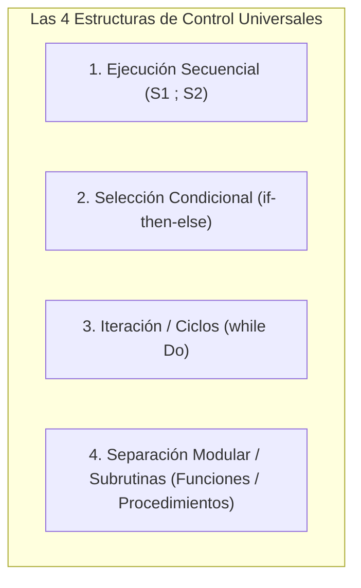
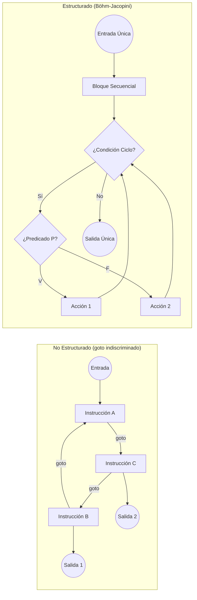
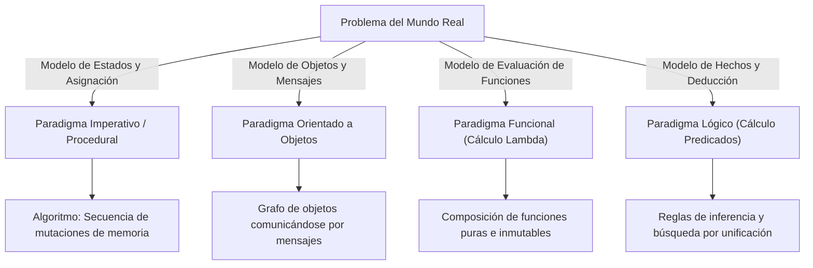
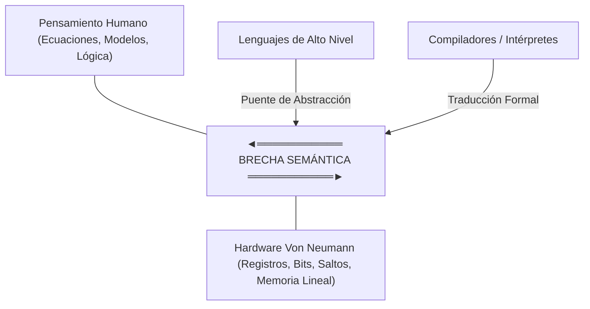

# Guía de Estudio Detallada: Semana 3 - Clase 1
**Curso:** Lenguajes de Programación  
**Profesor:** Jorge Arturo Vargas Calvo  
**Tema:** Fundamentos de Computabilidad, Definición Formal de Algoritmo, Teorema de Böhm-Jacopini y Principios de Diseño Profesional  
**Material de Base:** Grabación `Lenguajes semana 3 clase 1.mp4` (Duración: 01:43:52)

---

## 1. Definición Formal y Universal de Algoritmo

En las ciencias de la computación y la teoría de la computabilidad, la definición de un algoritmo no debe limitarse a la noción intuitiva de "receta de pasos". En este curso, se establece la **definición más general y rigurosa**:

> **Definición Formal:** Un algoritmo es una secuencia finita, ordenada y no ambigua de pasos o tareas deterministas que operan sobre un conjunto finito de datos de entrada, consumen una cantidad finita de recursos de memoria y tiempo de procesamiento, y terminan en un tiempo finito produciendo un resultado o salida bien definida.

### Propiedades Fundamentales que Caracterizan a un Algoritmo
1. **Finitud Espacial (Datos y Memoria):** El espacio requerido para almacenar las entradas, las variables intermedias y las estructuras de control debe ser estrictamente finito:
   $$\text{Espacio}(Algoritmo) \in \mathcal{O}(f(n)) < \infty, \quad \text{donde } n \text{ es el tamaño de la entrada.}$$
2. **Finitud Temporal (Terminación):** Para cualquier entrada válida en su dominio, el algoritmo debe detenerse tras un número finito de transiciones de estado. Un proceso que entra en un ciclo infinito no constituye formalmente un algoritmo.
3. **Determinismo (Definibilidad):** En cada paso del cómputo, dada una configuración de memoria y un estado del puntero de instrucción, existe un único paso siguiente posible (en el modelo secuencial clásico).
4. **Efectividad:** Cada instrucción debe ser elemental; es decir, realizable de forma exacta por el agente de cómputo (humano o máquina de estados finitos) en una duración medible.
5. **Entrada y Salida (Mapeo Funcional):** Un algoritmo materializa una función computable:
   $$f: I \to O$$
   donde $I$ es el conjunto de entradas válidas y $O$ es el conjunto de salidas esperadas.

---

## 2. El Teorema de la Estructura de Böhm y Jacopini (1966)

El resultado teórico fundacional de la programación estructurada fue publicado por los matemáticos italianos Corrado Böhm y Giuseppe Jacopini en su célebre artículo *"Flow diagrams, Turing machines and languages with only two formation rules"* (Communications of the ACM, 1966).

### 2.1 Enunciado del Teorema
> **Teorema:** Todo diagrama de flujo computable (y por ende cualquier función computable sobre una Máquina de Turing) puede transformarse en un programa equivalente que utilice exclusivamente **cuatro estructuras de control fundamentales**, poseyendo cada componente un único punto de entrada y un único punto de salida.



### 2.2 Desglose Matemático y Operacional de las 4 Estructuras

#### 1. Ejecución Secuencial
Composición binaria de instrucciones donde la finalización exitosa de la primera es precondición necesaria para el inicio de la segunda:
$$S_1 ; S_2 \implies \{P\} S_1 \{Q\} \land \{Q\} S_2 \{R\} \vdash \{P\} S_1 ; S_2 \{R\}$$
*(Expresado en Lógica de Hoare: la poscondición de $S_1$ es la precondición de $S_2$).*

#### 2. Selección / Decisión Condicional
Bifurcación del control basada en la evaluación de un predicado booleano $P$:
$$\text{if } P \text{ then } S_1 \text{ else } S_2$$
- Si $P = \text{verdadero}$, se ejecuta $S_1$.
- Si $P = \text{falso}$, se ejecuta $S_2$.
- Ambos caminos convergen forzosamente en un único punto de salida común.

#### 3. Iteración Subordinada (Ciclo `while`)
Repetición de un bloque de cómputo $S$ mientras se cumpla un predicado booleano invariante de control:
$$\text{while } P \text{ do } S$$
- El predicado $P$ se evalúa **antes** de ingresar al cuerpo del ciclo.
- Si $P = \text{falso}$ inicialmente, el cuerpo $S$ se ejecuta 0 veces.
- La ejecución de $S$ debe alterar variables del estado de tal forma que eventualmente $P$ se vuelva falso, garantizando la terminación.

#### 4. Separación Modular (Subrutinas / Abstracción Funcional)
Encapsulamiento de un bloque de cómputo bajo un identificador simbólico con paso de parámetros y contexto de memoria local:
$$f(x_1, x_2, \dots, x_n) \to y$$
Permite aislar la complejidad, crear jerarquías de llamada y evitar la duplicación de lógica.

---

### 2.3 El Debate Histórico y la Carta de Dijkstra (1968)
El teorema de Böhm-Jacopini proporcionó el sustento matemático para la histórica carta de Edsger W. Dijkstra: *"Go To Statement Considered Harmful"*.

* **El problema de `goto`:** La instrucción de salto incondicional rompe la correspondencia directa entre el **texto estático del programa** (código fuente) y el **proceso dinámico en tiempo de ejecución**. Destruye la capacidad del cerebro humano para realizar inducción matemática sobre el estado de las variables.
* **Reducción de `goto` a estructuras de Böhm-Jacopini:**
  Cualquier salto complejo o ciclo enmarañado ("código espagueti") puede traducirse a una estructura estructurada introduciendo **variables de estado auxiliares (banderas booleanas)** dentro de un bucle `while` subordinado a un `if-then-else`.



---

## 3. Los Paradigmas de Programación como Modelos Mentales

Un paradigma de programación no es una sintaxis o una librería: es una **perspectiva ontológica y epistemológica** sobre cómo estructurar el cómputo.
- Siguiendo la definición de Thomas Kuhn (*La estructura de las revoluciones científicas*), un paradigma provee al profesional:
  1. La forma de modelar las entidades del dominio.
  2. Las operaciones admisibles sobre dichas entidades.
  3. Los criterios para determinar qué constituye una solución válida, elegante y correcta.



> **Conclusión del Profesor:** El programador no debe casarse con un solo paradigma. Dominar diversos paradigmas dota al ingeniero de una "caja de herramientas cognitivas" donde cada herramienta es óptima para clases específicas de problemas.

---

## 4. Principios Fundamentales del Programador Profesional

En la clase se destacan dos máximas que rigen la ingeniería de software profesional y el diseño de lenguajes:

### Principio 1: *"La improvisación solo se justifica en caso de inopia"*
* **Definición de inopia:** Estado de pobreza extrema, escasez absoluta o indigencia de recursos (cognitivos, teóricos, instrumentales).
* **Implicación en Ingeniería:**
  - El software no debe construirse mediante ensayo y error caótico ("hackeo").
  - Si existen patrones formales, algoritmos probados, arquitecturas validadas y demostraciones matemáticas, improvisar es una falta a la ética profesional.
  - La improvisación solo es tolerable ante fronteras de conocimiento inexploradas donde no existe teoría previa.

### Principio 2: *Mantenibilidad y el Ciclo de Vida del Software*
* El costo del software no radica en el momento de escribirlo, sino en los años subsiguientes:
  $$\text{Costo Total de Propiedad (TCO)} = C_{\text{desarrollo}} + C_{\text{mantenimiento}}$$
  donde históricamente:
  $$C_{\text{desarrollo}} \approx 20\% \quad \text{vs.} \quad C_{\text{mantenimiento}} \approx 80\%$$
* Tipos de mantenimiento que justifican un código estructurado y modular:
  1. **Correctivo:** Reparación de fallas y errores imprevistos.
  2. **Adaptativo:** Ajustes por cambios de hardware, sistema operativo o plataformas.
  3. **Perfectivo:** Incorporación de nuevos requerimientos de negocio o usuario.
  4. **Preventivo:** Refactorización para reducir deuda técnica antes de que cause fallos.

---

## 5. La Brecha Semántica y la Máquina de Von Neumann

### 5.1 La Arquitectura Von Neumann
Casi la totalidad de los computadores físicos comerciales se fundamentan en el modelo Von Neumann:
1. Unidad Central de Procesamiento (CPU) con ALU y registros.
2. Memoria lineal addressable que almacena **indistintamente** tanto instrucciones como datos binarios.
3. Contador de programa ($PC$) que determina secuencialmente la siguiente instrucción a buscar (*fetch*), decodificar y ejecutar.
4. Bus de datos y direcciones (el cuello de botella de Von Neumann).

### 5.2 La Brecha Semántica (*Semantic Gap*)
Existe una desconexión fundamental entre:
- **El nivel del hardware:** Celdas de memoria, manipulación directa de bits, saltos incondicionales de bajo nivel (`JMP`, `BR`), instrucciones aritméticas sobre registros finitos.
- **El nivel del pensamiento humano:** Relaciones matemáticas abstractas, conjuntos, tipos complejos, contratos, objetos del mundo real y funciones lógicas.



### 5.3 Implementabilidad de Lenguajes
Un lenguaje de programación es implementable si existe un algoritmo de traducción determinista capaz de mapear cada constructo abstracto del lenguaje a secuencias de instrucciones de máquina equivalentes en tiempo de ejecución, conservando rigurosamente:
1. **Fidelidad Semántica:** El resultado obtenido en la máquina destino coincide exactamente con la especificación matemática del lenguaje fuente.
2. **Eficiencia de Recursos:** La sobrecarga introducida por la capa de abstracción (abstracción costosa vs. abstracción de costo cero) permanece dentro de márgenes aceptables.

---

## 6. Material Extra de Refuerzo para el Examen

### 6.1 Demostración de Reducción: ¿Por qué `repeat-until` y `for` no son estrictamente necesarios?
Böhm y Jacopini postulan que con solo `while` e `if` es suficiente. Observemos cómo se reduce cualquier otra estructura iterativa:

#### Reducción de `repeat-until`:
$$\text{repeat } S \text{ until } B \quad \Longleftrightarrow \quad S ; \quad \text{while } (\neg B) \text{ do } S$$

#### Reducción de `for`:
$$\text{for } i \leftarrow \text{inicio to fin do } S \quad \Longleftrightarrow \quad i \leftarrow \text{inicio} ; \quad \text{while } (i \le \text{fin}) \text{ do } \{ S ; i \leftarrow i + 1 \}$$

---

### 6.2 Ejercicio Práctico de Examen: Eliminación de Salto Incondicional (`goto`)

**Problema:** Suponga el siguiente fragmento arcaico no estructurado con saltos incondicionales:

```pascal
10: leer(x);
    if x < 0 then goto 40;
    y := sqrt(x);
    imprimir(y);
    goto 10;
40: if x = -999 then goto 60;
    imprimir('Error: numero negativo');
    goto 10;
60: imprimir('Fin del programa');
```

**Solución Estructurada según el Teorema de Böhm-Jacopini:**
Identificamos la condición de parada ($x = -999$), el bucle subordinado `while` y la bifurcación `if-then-else`:

```pascal
program VersionEstructurada;
var
    x, y: real;
    continuar: boolean;
begin
    continuar := true;
    while continuar do
    begin
        leer(x);
        if x = -999 then
            continuar := false
        else if x < 0 then
            imprimir('Error: numero negativo')
        else
        begin
            y := sqrt(x);
            imprimir(y);
        end;
    end;
    imprimir('Fin del programa');
end.
```
*Nótese cómo el código estructurado posee un único punto de entrada y un único punto de salida, permitiendo aplicar aserciones lógicas sobre cada bloque.*

---

### 6.3 Banco de Preguntas de Autoevaluación

1. **¿Cuál es la diferencia teórica fundamental entre un proceso computacional cualquiera y un algoritmo según la definición vista en clase?**
   * *Respuesta:* Un algoritmo exige rigurosamente finitud en tiempo, finitud en el uso de recursos y terminación garantizada para toda entrada válida, mientras que un proceso puede ser indefinido o infinito (como el ciclo de eventos de un sistema operativo).

2. **¿Cuáles son las cuatro estructuras de control universales del Teorema de Böhm-Jacopini?**
   * *Respuesta:* 1) Ejecución secuencial, 2) Selección condicional (`if-then-else`), 3) Iteración subordinada (`while`), 4) Separación modular o subrutinas.

3. **¿Por qué la instrucción `goto` hace que el software sea difícilmente verificable y mantenible?**
   * *Respuesta:* Porque rompe la correspondencia entre la estructura estática del texto del programa y el flujo dinámico temporal en ejecución, impidiendo el razonamiento inductivo y la formulación de invariantes de bucle de Hoare.

4. **¿A qué se refiere la frase *"La improvisación solo se justifica en caso de inopia"* en el contexto del diseño de software?**
   * *Respuesta:* A que el desarrollo de software es una disciplina rigurosa de ingeniería donde la improvisación es inadmisible si existen teorías, algoritmos formales o estándares previos; únicamente se admite cuando se carece por completo de conocimiento previo o herramientas aplicables al problema.
