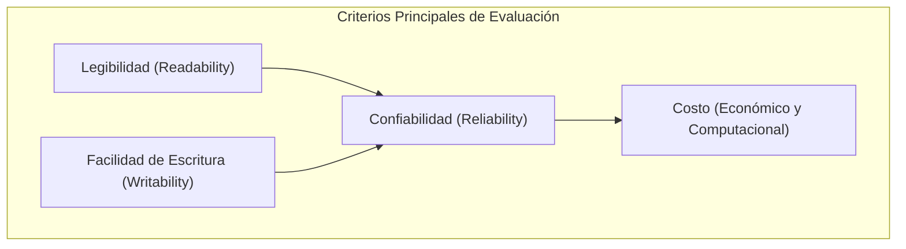
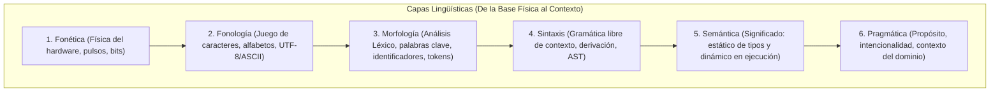

# Guía de Estudio Detallada: Semana 3 - Clase 2
**Curso:** Lenguajes de Programación  
**Profesor:** Jorge Arturo Vargas Calvo  
**Tema:** Criterios y Filosofía de Diseño de Lenguajes, Ambigüedad Sintáctica (Dangling Else) y el Modelo Concéntrico de Capas Lingüísticas  
**Material de Base:** Grabación `Lenguajes semana 3 clase 2.mp4` (Duración: 01:43:55)

---

## 1. Criterios Formales de Evaluación y Diseño de Lenguajes

El diseño de un lenguaje de programación es una disciplina de compromisos (*trade-offs*). No existe el "lenguaje perfecto", sino lenguajes optimizados para criterios específicos.



### 1.1 Legibilidad (*Readability*)
Facilidad con la cual un ser humano puede inspeccionar el código fuente y deducir inequívocamente su comportamiento y propósito:
- **Simplicidad general:** Un lenguaje con demasiadas características o constructos redundantes confunde al lector.
- **Ortogonalidad:** La capacidad de predecir el comportamiento al combinar constructos primitivos.
- **Estructuras de control claras:** Código legible de arriba hacia abajo sin saltos espagueti.
- **Tipos de datos y estructuras expresivas:** Facilidad para definir abstracciones acordes al dominio.

### 1.2 Facilidad de Escritura (*Writability*)
Medida en que el lenguaje permite expresar algoritmos de forma concisa y natural para el dominio del problema:
- **Soporte para abstracción:** Capacidad de definir y usar estructuras complejas u operaciones sin preocuparse por detalles de bajo nivel.
- **Expresividad:** Operadores de alto nivel (ej. comprensiones de listas, operaciones matriciales directas).

> [!WARNING]
> Una concisión extrema en la escritura suele destruir la legibilidad (ejemplo clásico: APL o código con exceso de expresiones regulares crípticas).

### 1.3 Confiabilidad (*Reliability*)
Un programa es confiable si se comporta conforme a sus especificaciones bajo cualquier condición de ejecución:
- **Chequeo de tipos (*Type Checking*):** Detección de incompatibilidades semánticas (estático en compilación o dinámico en ejecución).
- **Manejo de excepciones:** Capacidad de interceptar fallos en tiempo de ejecución (`try-catch-finally`) sin provocar caídas desastrosas del sistema.
- **Restricción de aliasing:** Evitar que múltiples identificadores o punteros apunten a la misma celda de memoria modificable de forma inadvertida.

### 1.4 Naturalidad vs. Universalidad
- **Naturalidad:** El grado de concordancia y correspondencia entre las estructuras sintácticas del lenguaje y las fórmulas/entidades del dominio (ej. SQL para consultas relacionales, R para estadística, Fortran para fórmulas algebraicas).
- **Universalidad:** Capacidad de cómputo general (Turing-completitud). Un lenguaje universal puede simular cualquier proceso computable, aunque para ciertos dominios su código resulte antinatural o verboso.

### 1.5 Ortogonalidad: Definición Formal y Ejemplos
> **Definición:** En un lenguaje de programación, la **ortogonalidad** implica que un conjunto pequeño de constructos primitivos puede combinarse en cualquier orden y forma, produciendo siempre resultados coherentes y sin excepciones arbitrarias ni efectos secundarios inesperados.

#### Ejemplo de ALTA ortogonalidad (Algol 68):
En Algol 68, cualquier expresión que produzca un valor de un tipo $T$ puede utilizarse en cualquier lugar donde se requiera un valor de tipo $T$ (dentro de asignaciones, argumentos de funciones, retornos de funciones, condicionales).

#### Ejemplo de BAJA ortogonalidad (Lenguaje C clásico):
En C existen restricciones arbitrarias que rompen la ortogonalidad:
1. Una función puede retornar una estructura (`struct`), pero **no puede retornar un arreglo** (`array`) directamente.
2. Los parámetros pueden pasarse por valor, pero los arreglos **siempre decaen a punteros** y se pasan por referencia simulada.
3. Se puede asignar una estructura a otra directamente con `=`, pero **no se puede asignar un arreglo a otro** con `=` (requiere bucle o `memcpy`).

---

## 2. Sintaxis y Ambigüedad Formal

### 2.1 Gramáticas Libres de Contexto (CFG) y BNF
Una gramática formal se define como una 4-tupla:
$$G = (V_N, V_T, P, S)$$
donde:
- $V_N$: Conjunto finito de símbolos no terminales (categorías sintácticas).
- $V_T$: Conjunto finito de símbolos terminales (tokens o palabras clave).
- $P$: Conjunto de reglas de producción de la forma $A \to \alpha$, con $A \in V_N$ y $\alpha \in (V_N \cup V_T)^*$.
- $S \in V_N$: Símbolo inicial de la gramática.

### 2.2 Definición Formal de Ambigüedad
> **Definición:** Una gramática $G$ es **ambigua** si existe al menos una cadena $w \in L(G)$ para la cual existen **dos o más árboles de análisis sintáctico (AST) distintos** (o equivalentemente, dos o más derivaciones más a la izquierda / *leftmost derivations* distintas).

---

### 2.3 El Problema del *Dangling Else* (El `else` colgante)

Considere la siguiente gramática clásica simplificada para sentencias condicionales:

$$\begin{aligned}
\text{Stmt} &\to \text{if } \text{Expr} \text{ then } \text{Stmt} \\
            &\mid \text{if } \text{Expr} \text{ then } \text{Stmt} \text{ else } \text{Stmt} \\
            &\mid \text{asignacion} \mid \text{otro}
\end{aligned}$$

Suponga la siguiente sentencia concreta (analizada en clase en Pascal):
```pascal
if A < 2 then if A > 10 then write('X') else write('Y');
```

#### Los Dos Árboles Sintácticos Posibles:

```
           ÁRBOL SINTÁCTICO 1                            ÁRBOL SINTÁCTICO 2
    (Asociación al IF exterior)                   (Asociación al IF interior - Estándar)

              Stmt                                          Stmt
            /   |   \                                     /   |   \    \
          if  Expr  then   Stmt                         if  Expr  then  Stmt
               |             |                               |           / | \ \
             A < 2          Stmt                           A < 2       if  E then S else S
                          /   |   \                                        |      |    |
                        if  Expr  then S                                 A > 10   'X' 'Y'
                             |         |
                           A > 10     'X'
                          /
                       else
                        |
                       'Y'
```

#### Consecuencia Semántica del Conflicto:
- **Bajo la Interpretación 1 (asociado al IF externo):**
  Si $A = 5$, la condición $A < 2$ es falsa. Por lo tanto, se ejecutaría la rama `else`, imprimiendo `'Y'`.
- **Bajo la Interpretación 2 (asociado al IF interno - regla oficial):**
  Si $A = 5$, la condición $A < 2$ es falsa, por lo que **todo el bloque condicional se omite** y no se imprime absolutamente nada.

#### Métodos de Resolución del Problema:
1. **Regla Semántica Ad-Hoc en el Compilador:** La mayoría de los compiladores de Pascal y C implementan la regla de que el `else` se asocia siempre con el `if` más cercano no cerrado.
2. **Reescritura de la Gramática Formal (Gramática no ambigua):** Dividir las sentencias en **cerradas/coincidentes** (`MatchedStmt`) y **abiertas/no coincidentes** (`OpenStmt`):
   $$\begin{aligned}
   \text{Stmt} &\to \text{MatchedStmt} \mid \text{OpenStmt} \\
   \text{MatchedStmt} &\to \text{if } \text{Expr} \text{ then } \text{MatchedStmt} \text{ else } \text{MatchedStmt} \mid \text{otro} \\
   \text{OpenStmt} &\to \text{if } \text{Expr} \text{ then } \text{Stmt} \\
                  &\mid \text{if } \text{Expr} \text{ then } \text{MatchedStmt} \text{ else } \text{OpenStmt}
   \end{aligned}$$
3. **Cierres Sintácticos Explícitos en el Lenguaje:**
   - Pascal: `begin ... end`
   - C / C++ / Java: `{ ... }`
   - Ada / Python / Algol 68: `endif`, indentación significativa o `fi`.

---

## 3. El Modelo Concéntrico de las 6 Capas Lingüísticas

El profesor presenta la estructura de los lenguajes de programación mediante un modelo concéntrico derivado de la lingüística formal:



### 3.1 Análisis Detallado de Cada Capa y su Contraparte Informática

| Capa Lingüística | Equivalente en Lingüística Natural | Contraparte en Ciencias de la Computación | Componente / Herramienta | Ejemplo de Error Típico |
| :--- | :--- | :--- | :--- | :--- |
| **1. Fonética** | Producción física del sonido, frecuencias y fonos. | Niveles lógicos de voltaje, estados cuánticos, pulsos de reloj, patrones físicos de bits. | Transistores, compuertas lógicas, bus de datos físico. | Ruido eléctrico, fallo de memoria física (*bit flip* por rayos cósmicos). |
| **2. Fonología** | Fonemas: unidades mínimas abstractas de sonido distintivo. | Codificación de caracteres admisible en el lenguaje fuente (ASCII, Unicode UTF-8). | Mapeos de codificación, tabla de caracteres válida. | Carácter no imprimible o ilegal en el archivo fuente (ej. carácter nulo embebido `\0`). |
| **3. Morfología** | Morfemas, lexemas, prefijos y sufijos que componen palabras. | **Análisis Léxico (*Scanner*):** División del flujo de caracteres en **tokens** (palabras reservadas, identificadores, constantes numéricas, operadores). | Autómatas Finitos Deterministas (DFA), Expresiones Regulares (herramientas como `Lex` / `Flex`). | Identificador inválido (ej. `123variable`), literal de texto sin cerrar (`"hola mundo`). |
| **4. Sintaxis** | Gramática: reglas para formar oraciones y sintagmas coherentes. | **Análisis Sintáctico (*Parser*):** Verificación de que la secuencia de tokens satisface las reglas de la gramática libre de contexto (CFG) y construcción del AST. | Parsers descendentes (LL) o ascendentes (LR/LALR, herramientas como `Yacc` / `Bison`). | Paréntesis desbalanceados, omisión de punto y coma, sentencia condicional mal formada. |
| **5. Semántica** | Significado literal y coherencia lógica de las oraciones. | **Análisis Semántico y Ejecución:** Verificación estática (comprobación de tipos, alcance de variables, tablas de símbolos) y semántica operacional dinámica (valores resultantes en memoria). | Comprobador de tipos (*Type Checker*), Tabla de Símbolos, Intérprete / Máquina Virtual. | Error semántico estático: sumar un entero con un puntero incompatible; Error dinámico: división por cero. |
| **6. Pragmática** | Significado contextual, intención del hablante, adecuación al discurso. | **Uso Contextual e Intención:** ¿Resuelve el programa el problema del usuario? Uso idiomático de APIs, rendimiento, patrones de diseño y conveniencia del paradigma. | Arquitectura de software, librerías del dominio, buenas prácticas de ingeniería. | Usar un algoritmo $\mathcal{O}(n^3)$ para un sistema en tiempo real; usar C para procesar JSON cuando Python es idóneo. |

---

## 4. Material Extra de Refuerzo para el Examen

### 4.1 Matriz de Clasificación de Errores por Capa
En el examen suele solicitarse identificar a qué capa del modelo corresponde un error específico:

1. `int 9valor = 50;` $\to$ **Error Léxico / Morfológico:** El tokenizador rechaza un identificador que inicia con un dígito decimal.
2. `if (a > 0 then x = 1;` $\to$ **Error Sintáctico:** Falta el paréntesis de cierre `)` requerido por la regla sintáctica de C.
3. `int *p = 3.14159;` $\to$ **Error Semántico Estático:** Incompatibilidad de tipos detectada en compilación (asignación de `float` a puntero `int *`).
4. `int x = 10 / 0;` $\to$ **Error Semántico Dinámico:** Excepción de división entre cero en tiempo de ejecución.
5. El algoritmo calcula la serie de Fibonacci pero la función no contempla números negativos y se cuelga $\to$ **Defecto Semántico / Pragmático:** Violación del contrato de precondiciones.

---

### 4.2 Ejercicio Práctico Resuelto: Desambiguación Gramatical

**Pregunta de Examen:** Dada la siguiente gramática aritmética clásica:
$$E \to E + E \mid E * E \mid \text{id}$$

1. Demuestre que es ambigua para la cadena $\text{id} + \text{id} * \text{id}$.
2. Reescriba la gramática para hacerla no ambigua, respetando que la multiplicación tiene mayor precedencia que la suma y que ambos operadores son asociativos a la izquierda.

#### Solución:
**1. Demostración de ambigüedad:**
Podemos construir dos derivaciones más a la izquierda (*leftmost*):
- *Derivación A (da prioridad al producto):*
  $$E \Rightarrow E + E \Rightarrow \text{id} + E \Rightarrow \text{id} + E * E \Rightarrow \text{id} + \text{id} * \text{id}$$
- *Derivación B (da prioridad a la suma):*
  $$E \Rightarrow E * E \Rightarrow E + E * E \Rightarrow \text{id} + E * E \Rightarrow \text{id} + \text{id} * E \Rightarrow \text{id} + \text{id} * \text{id}$$
Al existir dos árboles sintácticos distintos para la misma cadena, la gramática es ambigua.

**2. Gramática desambiguada:**
Introducimos jerarquía de no terminales: $E$ (expresiones aditivas), $T$ (términos multiplicativos) y $F$ (factores o elementos atómicos):
$$\begin{aligned}
E &\to E + T \mid T \\
T &\to T * F \mid F \\
F &\to \text{id} \mid ( E )
\end{aligned}$$
*Esta gramática garantiza que el producto se resuelva en niveles más profundos del árbol sintáctico (mayor precedencia) y que la recursión por la izquierda fuerce la asociatividad por la izquierda.*

---

### 4.3 Banco de Preguntas de Autoevaluación

1. **¿Qué relación existe entre la ortogonalidad de un lenguaje y su confiabilidad?**
   * *Respuesta:* Una alta ortogonalidad favorece la confiabilidad porque reduce la cantidad de reglas especiales y excepciones sintácticas que el programador debe memorizar, minimizando la aparición de errores no previstos. Sin embargo, un exceso de ortogonalidad mal regulado puede permitir combinaciones extrañas que compliquen la detección estática de errores.

2. **¿Cómo se soluciona formalmente el problema del *Dangling Else* a nivel sintáctico en un compilador moderno sin modificar la gramática?**
   * *Respuesta:* Mediante una regla de desambiguación pragmática en la tabla de análisis sintáctico del parser (resolución de conflictos *shift/reduce* dando preferencia a la acción *shift*), lo que asocia automáticamente el `else` con el `if` más inmediato.

3. **¿Cuál es la función exacta de la capa morfológica en el proceso de compilación?**
   * *Respuesta:* La capa morfológica se materializa en el **analizador léxico (scanner)**, cuya tarea es leer la secuencia lineal de caracteres del código fuente y agruparlos en unidades con significado léxico llamadas **tokens**, descartando comentarios y espacios en blanco.

4. **Explique la diferencia entre Semántica Estática y Semántica Dinámica:**
   * *Respuesta:* La **Semántica Estática** comprende todas las restricciones y significados que pueden validarse durante la compilación sin ejecutar el programa (ej. comprobación de tipos, verificación de que las variables estén declaradas en el ámbito actual). La **Semántica Dinámica** define el significado de las instrucciones durante la ejecución y la forma en que el estado de la memoria y la máquina se transforma en el tiempo.
