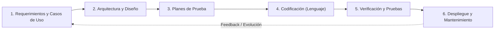
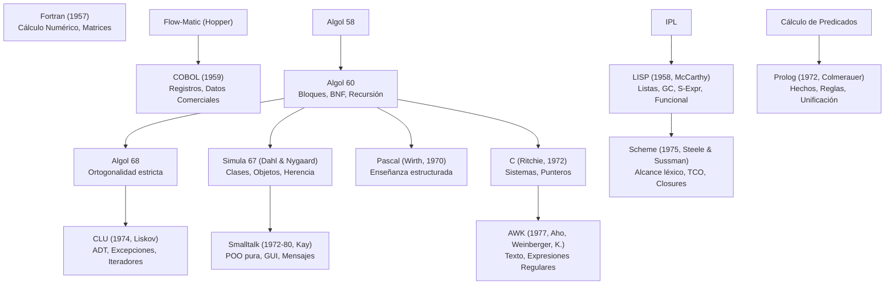
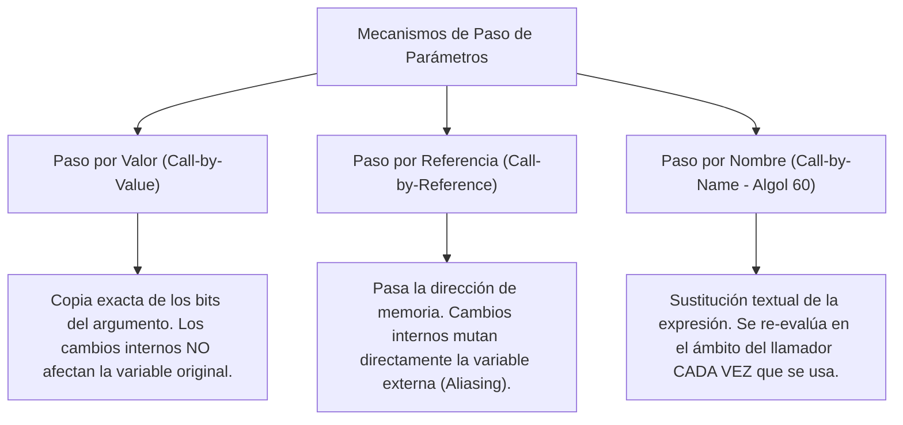

# Guía de Estudio Detallada: Semana 4 - Clase 1
**Curso:** Lenguajes de Programación  
**Profesor:** Jorge Arturo Vargas Calvo  
**Tema:** Ciclo de Vida del Software, Taxonomía de Paradigmas de Programación y Genealogía Fundacional de Lenguajes (1950 - 1980)  
**Material de Base:** Grabación `Lenguajes semana 4 clase 1.mp4` (Duración: 01:39:22)

---

## 1. El Ciclo de Vida del Software y el Diseño de Lenguajes

En la ingeniería de software profesional, la creación de un sistema trasciende ampliamente la fase de codificación. La clase enfatiza las fases formales del ciclo de vida y cómo las características de los lenguajes de programación están diseñadas para apoyar o mitigar riesgos en cada una de ellas:



### 1.1 El Costo del Error según la Fase de Detección
La regla clásica de Barry Boehm demuestra que el coste de corregir un defecto crece exponencialmente a medida que avanza el ciclo:
- Un error de diseño conceptual o de requerimiento detectado en la fase 1 cuesta $1\times$.
- Ese mismo error detectado en la fase de codificación cuesta de $5\times$ a $10\times$.
- El mismo defecto detectado en producción/mantenimiento puede costar entre $50\times$ y $100\times$.

### 1.2 Influencia del Lenguaje en el Ciclo de Vida
1. **Fase de Diseño y Tipos de Datos:** Lenguajes con sistemas de tipos estáticos ricos (ej. Haskell, Rust, Ada) permiten capturar invariantes del dominio directamente en las firmas de tipo, imposibilitando estados inválidos antes de escribir código operativo (*"Make illegal states unrepresentable"*).
2. **Fase de Pruebas:** Funciones puras (paradigma funcional) eliminan dependencias de estado oculto y base de datos, posibilitando pruebas unitarias deterministas sin necesidad de mocks complejos.
3. **Fase de Mantenimiento:** La legibilidad y la modularidad estricta (ocultamiento de información propuesto por Parnas) reducen el tiempo necesario para comprender y modificar código legado.

---

## 2. Taxonomía Exhaustiva de Paradigmas de Programación

Un paradigma define el modelo de computación fundamental asumido por el programador. A continuación se presenta la matriz taxonómica rigurosa de los paradigmas discutidos en clase:

| Paradigma | Unidad Básica de Abstracción | Mecanismo de Control | Manejo del Estado | Fundamento Teórico | Lenguajes Representativos |
| :--- | :--- | :--- | :--- | :--- | :--- |
| **Imperativo / Procedural** | Procedimiento / Subrutina / Función | Secuenciación, bucles iterativos (`while`, `for`), saltos condicionales. | **Mutable:** Celdas de memoria sobrescritas destructivamente mediante asignación (`x = x + 1`). | Máquina de Turing / Arquitectura Von Neumann | Pascal, C, Fortran, Algol |
| **Orientado a Objetos (POO)** | Objeto (agrupación de estado y comportamiento) | Paso de mensajes, invocación de métodos, despacho dinámico (*polimorfismo*). | **Encapsulado mutable:** Estado protegido dentro del objeto y manipulable solo vía interfaz pública. | Teoría de Tipos Abstractos (ADT) y Actores | Smalltalk, Java, C++, C# |
| **Funcional** | Función Matemática Pura | Evaluación y composición de funciones, recursión pura, funciones de orden superior. | **Inmutable:** No existen variables destructivas; ligaduras constantes (*bindings*) y transparencia referencial. | Cálculo Lambda de Alonzo Church | Haskell, Scheme, Lisp, OCaml |
| **Lógico / Declarativo** | Cláusula de Horn / Predicado | Resolución SLD (*Selective Linear Definite*), algoritmo de unificación y *backtracking*. | **Sin estado / Lógico:** Sustitución y unificación de términos lógicos sobre bases de conocimiento. | Lógica de Predicados de Primer Orden | Prolog, Datalog, Mercury |
| **Scripting / Interpretado** | Script / Módulo / Expresiones Regulares | Interpretación directa paso a paso, ligadura tardía (*late binding*), tipado dinámico. | **Mutable dinámico:** Tipos asociados al valor en ejecución y no a la variable. | Automatización y procesamiento de texto | Python, Bash, Perl, Ruby, AWK |
| **Concurrente / Paralelo** | Hilo / Proceso / Actor / Canal | Sincronización mediante semáforos, cerrojos (*locks*), monitores o paso de mensajes asíncrono. | **Memoria compartida o buzones aislados:** Requiere control de condiciones de carrera (*race conditions*). | Cálculo de Procesos (CSP de Hoare, $\pi$-calculus) | Erlang, Go, Ada, Rust |

---

## 3. Genealogía Técnica de los Lenguajes Fundacionales (1950 - 1980)

El profesor analiza el gran árbol genealógico de la programación. A continuación se sintetizan los hitos técnicos y aportes estructurales de cada lenguaje, prescindiendo de anécdotas secundarias:



### 3.1 Fortran (1957 - John Backus, IBM)
- **Aporte Técnico Principal:** Primer lenguaje de alto nivel con un compilador optimizador comercialmente exitoso.
- **Innovaciones de Diseño:**
  - Introducción de expresiones aritméticas infijas complejas ($A = B * C + D$).
  - Arreglos multidimensionales homogéneos almacenados de forma contigua en memoria (orden por columnas o *column-major order*).
  - Estructura de control iterativa estandarizada (`DO loop`).

### 3.2 COBOL (1959 - Comité CODASYL / Grace Hopper)
- **Aporte Técnico Principal:** Primer lenguaje diseñado para procesamiento comercial y manipulación masiva de registros empresariales.
- **Innovaciones de Diseño:**
  - Separación formal de la especificación de datos y la lógica procedimental en cuatro divisiones:
    1. `IDENTIFICATION DIVISION`: Metadatos del sistema.
    2. `ENVIRONMENT DIVISION`: Mapeo de archivos y hardware.
    3. `DATA DIVISION`: Definición estructurada de memoria y registros.
    4. `PROCEDURE DIVISION`: Algoritmos e instrucciones.
  - Creación del tipo de dato **Registro Compuesto Jerárquico** mediante números de nivel:
    ```cobol
    01  REGISTRO-EMPLEADO.
        05  ID-NUMERO       PIC 9(6).
        05  NOMBRE-COMPLETO.
            10  PRIMER-NOMBRE PIC X(20).
            10  APELLIDO      PIC X(20).
        05  SALARIO-BASE     PIC 9(7)V99.
    ```
  - Aritmética decimal de punto fijo exacta (evitando los errores de redondeo de punto flotante binario en transacciones financieras).

### 3.3 LISP (1958 - John McCarthy, MIT)
- **Aporte Técnico Principal:** Fundamento del cómputo funcional y procesamiento simbólico en Inteligencia Artificial.
- **Innovaciones de Diseño:**
  - **Homoiconicidad:** El código del programa se representa mediante la misma estructura de datos que manipula (Expresiones S / listas entre paréntesis):
    $$\text{Código} \equiv \text{Datos}$$
  - **Recolección Automática de Basura (*Garbage Collection*):** Primer lenguaje en desvincular al programador de la liberación manual de memoria (algoritmo *Mark and Sweep*).
  - **Estructura de Datos Lista Enlazada (`CONS`, `CAR`, `CDR`):**
    - `cons`: Constructor de pares.
    - `car` (*Contents of Address Register*): Cabeza o primer elemento.
    - `cdr` (*Contents of Decrement Register*): Cola o resto de la lista.
  - Funciones como ciudadanos de primera clase y soporte pleno para recursión profunda.

### 3.4 Algol 60 (Comité Internacional IFIP)
- **Aporte Técnico Principal:** El ancestro universal de los lenguajes imperativos estructurados modernos.
- **Innovaciones de Diseño:**
  - Definición formal de la sintaxis mediante la notación **BNF (Backus-Naur Form)**.
  - **Estructura de Bloques con Alcance Léxico (`begin ... end`):** Posibilidad de declarar variables locales visibles únicamente dentro de su bloque delimitado.
  - Gestión de memoria basada en pila de llamadas (*call stack*), habilitando la recursión algorítmica por primera vez en lenguajes procedurales.
  - **Mecanismos de Paso de Parámetros:** Introducción del paso por valor y del polémico **paso por nombre** (*Call-by-Name*).

### 3.5 Simula 67 (Ole-Johan Dahl y Kristen Nygaard, Centro de Computación de Noruega)
- **Aporte Técnico Principal:** Nacimiento formal del **Paradigma Orientado a Objetos**.
- **Innovaciones de Diseño:**
  - Diseñado inicialmente para simulaciones de eventos discretos (barcos, colas en puertos, tráfico).
  - Introducción formal de las **Clases** como plantillas y los **Objetos** como instancias dinámicas en el montículo (*heap*).
  - Jerarquías de clases mediante **Subclases y Herencia**.
  - Métodos virtuales y polimorfismo dinámico.
  - **Corrutinas:** Métodos que pueden pausar voluntariamente su ejecución (`detach`) y reanudarse posteriormente (`resume`), precursoras directas de los generadores modernos.

### 3.6 Smalltalk (Alan Kay, Dan Ingalls, Adele Goldberg en Xerox PARC)
- **Aporte Técnico Principal:** La máxima pureza del paradigma orientado a objetos y entorno integrado GUI.
- **Innovaciones de Diseño:**
  - **Pureza Ontológica Absoluta:** *"Todo es un objeto"*. Los números enteros, los bloques de código y las clases mismas son objetos con estado y métodos.
  - **Comunicación Estricta por Paso de Mensajes:** La llamada a un método no es un salto de subrutina estático, sino el envío dinámico de un mensaje a un receptor:
    ```smalltalk
    3 + 4   "Envía el mensaje '+' con argumento 4 al objeto receptor 3"
    ```
  - Eliminación de estructuras de control rígidas del lenguaje: las bifurcaciones y ciclos son mensajes enviados a objetos booleanos:
    ```smalltalk
    (x > 0) ifTrue: [ y := 1 ] ifFalse: [ y := -1 ]
    ```

### 3.7 Scheme (1975 - Gerald Jay Sussman y Guy L. Steele Jr., MIT)
- **Aporte Técnico Principal:** Dialecto de LISP minimalista que redefinió la teoría de lenguajes.
- **Innovaciones de Diseño:**
  - **Alcance Estático / Léxico Obligatorio:** Las variables resuelven su vinculación según la estructura estática del texto fuente y no según la pila dinámica de llamadas, posibilitando las **clausuras léxicas (*closures*)**.
  - **Optimización Obligatoria de Llamada de Cola (*Tail-Call Optimization - TCO*):** Toda llamada a función que ocurra en posición de cola debe reutilizar el marco de pila actual, permitiendo que la recursión reemplace a los bucles imperativos con costo de memoria espacial $\mathcal{O}(1)$.
  - **Continuaciones de Primera Clase (`call/cc`):** Capacidad de capturar el estado futuro de la computación como un objeto invocable, permitiendo implementar excepciones, corrutinas y backtracking sin soporte nativo del compilador.

### 3.8 Prolog (1972 - Alain Colmerauer y Robert Kowalski)
- **Aporte Técnico Principal:** Materialización de la programación lógica declarativa.
- **Innovaciones de Diseño:**
  - Basado en un subconjunto de la lógica de predicados: las **Cláusulas de Horn** ($A \leftarrow B_1 \land B_2 \land \dots \land B_n$).
  - **Motor de Inferencia Automático:** El programador no describe el algoritmo paso a paso (*"cómo resolver"*), sino que describe los axiomas del dominio (*"qué es verdad"*).
  - Algoritmo de **Unificación de Términos Simbólicos** y búsqueda recursiva con retroceso (*backtracking*).

### 3.9 CLU (1974 - Barbara Liskov, MIT)
- **Aporte Técnico Principal:** Sistematización del concepto de **Tipo Abstracto de Datos (ADT)**.
- **Innovaciones de Diseño:**
  - Precursor de los tipos genéricos y plantillas parametrizadas (`array[T]`).
  - Separación tajante entre la interfaz pública de una estructura y su implementación interna oculta.
  - Manejo estructurado y seguro de excepciones (`signal` / `except`).
  - Introducción formal de generadores iterables mediante sentencias `yield`.

### 3.10 AWK (1977 - Alfred Aho, Peter Weinberger, Brian Kernighan)
- **Aporte Técnico Principal:** Lenguaje orientado al procesamiento de flujos de texto estructurado en registros y columnas.
- **Innovaciones de Diseño:**
  - Arquitectura basada en pares `Patrón { Acción }`.
  - División automática de cada línea en campos accesibles mediante variables posicionales (`$1, $2, \dots, $NF`).
  - Arreglos asociativos nativos (tablas hash direccionadas por cadenas).

---

## 4. Material Extra de Refuerzo para el Examen

### 4.1 Análisis Comparativo de Mecanismos de Paso de Parámetros
Uno de los temas evaluados en teoría de compiladores y lenguajes es el impacto semántico del paso de argumentos:



#### El Dispositivo de Jensen (*Jensen's Device*) en Algol 60:
Gracias al paso por nombre, Algol 60 permitía expresar sumatorias matemáticas generales pasando una variable índice y una expresión que dependía de dicho índice:

$$\sum_{i=1}^{n} V(i)$$

En Algol 60:
```algol
real procedure Sum(k, lower, upper, expr);
    value lower, upper;
    integer k, lower, upper;
    real expr;
begin
    real s;
    s := 0;
    for k := lower step 1 until upper do
        s := s + expr;  ! 'expr' se evalúa en cada ciclo con el nuevo valor de k !
    Sum := s
end;
```
*Si se llamaba como `Sum(i, 1, 100, A[i])`, la expresión `A[i]` se re-evaluaba con el valor actualizado de $i$ en cada iteración.*

---

### 4.2 Banco de Preguntas de Autoevaluación

1. **¿Qué diferencia conceptual fundamental existe entre la estructura de objetos en Simula 67 y en Smalltalk?**
   * *Respuesta:* En Simula 67 los objetos coexisten con el modelo procedural clásico de Algol y las llamadas a métodos son invocaciones estáticas o indirectas con verificación de tipos. En Smalltalk la orientación a objetos es ontológicamente pura ("todo es un objeto"), no existen tipos primitivos y la ejecución se basa enteramente en el paso dinámico de mensajes a receptores en tiempo de ejecución.

2. **¿Por qué la introducción de las Cláusulas de Horn fue decisiva para el surgimiento práctico de Prolog?**
   * *Respuesta:* Porque la demostración automática de teoremas en la lógica general de primer orden es computacionalmente intratable (indecidible o con complejidad factorial/exponencial inmanejable). Al restringir las fórmulas lógicas a Cláusulas de Horn (a lo sumo un literal positivo), el algoritmo de resolución SLD permite una búsqueda lineal determinista y eficiente mediante unificación y retroceso.

3. **¿Cuál fue la contribución de Gerald Sussman y Guy Steele con Scheme respecto a la memoria y la recursión?**
   * *Respuesta:* Impusieron por especificación de lenguaje que toda llamada recursiva en posición de cola debe ejecutarse con Optimización de Llamada de Cola (TCO), reutilizando el marco de pila del llamador. Esto garantizó que algoritmos iterativos expresados recursivamente se ejecuten con consumo de memoria constante $\mathcal{O}(1)$, demostrando que los bucles imperativos son innecesarios.

4. **¿Cómo influyó el lenguaje CLU de Barbara Liskov en la evolución hacia la programación modular y orientada a objetos moderna?**
   * *Respuesta:* CLU formalizó el concepto de Tipo Abstracto de Datos (ADT), introduciendo el encapsulamiento estricto de la representación interna, los generadores iterativos (`yield`), el manejo formal de excepciones estructuradas y la parametrización de tipos (semilla de las plantillas en C++ y genéricos en Java/C#).
