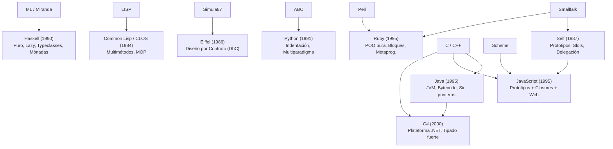
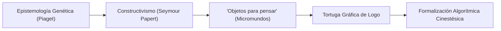
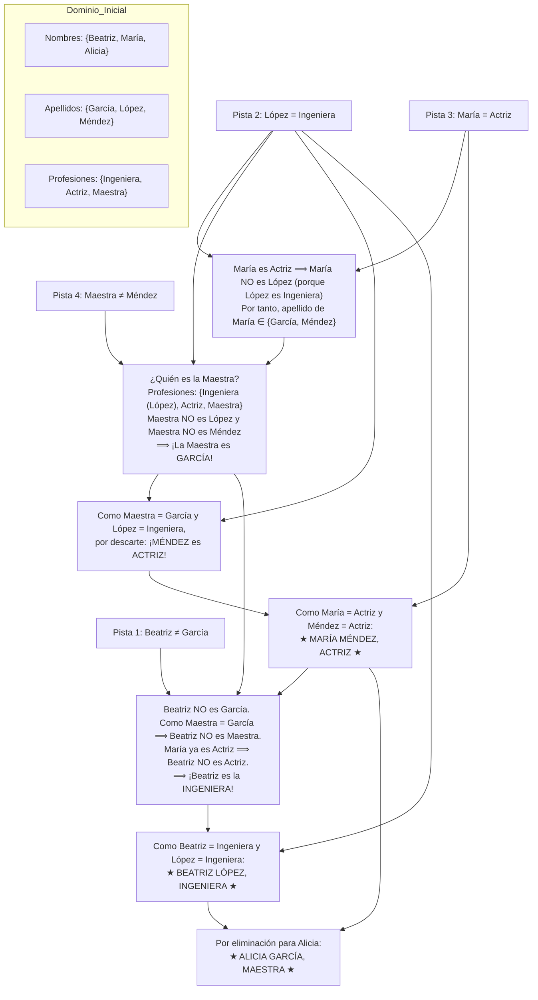

# Guía de Estudio Detallada: Semana 4 - Clase 2
**Curso:** Lenguajes de Programación  
**Profesor:** Jorge Arturo Vargas Calvo  
**Tema:** Genealogía Técnica Moderna (1980 - Actualidad), Constructivismo (Logo / KTurtle) y los Tres Problemas Representativos de Asignación  
**Material de Base:** Grabación `Lenguajes semana 4 clase 2.mp4` (Duración: 01:39:01)

---

## 1. Genealogía Técnica de los Lenguajes Modernos (1980 - 2000s)

Continuando con la evolución de los lenguajes, la clase analiza los hitos técnicos de la era moderna, destacando sus innovaciones arquitecturales y descartando anécdotas accesorias:



### 1.1 Haskell 1.0 (1990 - Comité Haskell)
- **Aportes Técnicos Primordiales:**
  - **Funcional Puro y No Estricto:** La evaluación por defecto es perezosa (*lazy evaluation* o *call-by-need*). Las expresiones solo se reducen cuando su valor es indispensable para interactuar con el entorno observable.
  - **Sistema de Tipos Hindley-Milner:** Inferencia de tipos estática completa sin necesidad de anotaciones redundantes de tipos en cada variable local.
  - **Clases de Tipos (*Typeclasses*):** Mecanismo para resolver el polimorfismo ad-hoc (sobrecarga de operadores) de manera matemáticamente rigurosa y segura (ej. clases `Eq`, `Ord`, `Num`, `Show`).
  - **Aislamiento de Efectos mediante Mónadas:** La entrada/salida y las operaciones con estado no rompen la pureza matemática, sino que se modelan algebraicamente dentro del tipo de datos mónada `IO a`.

### 1.2 Common Lisp y CLOS (1984 - 1988)
- **Aportes Técnicos Primordiales:**
  - **Multimétodos y Despacho Múltiple (*Multiple Dispatch*):** En lenguajes como C++, Java o Python, la llamada `objeto.metodo(arg)` es monomórfica respecto al receptor (solo depende del tipo de `objeto` o `this`). En CLOS, un método pertenece a una función genérica y el método específico a invocar se elige en tiempo de ejecución considerando la combinación de tipos de **todos** sus argumentos.
  - **Protocolo de Meta-Objetos (MOP):** Capacidad del lenguaje para redefinir su propio compilador y modelo de objetos desde dentro del mismo código.

### 1.3 Self (David Ungar y Randall Smith)
- **Aportes Técnicos Primordiales:**
  - **Programación Basada en Prototipos:** Eliminación de la dicotomía formal entre clase (molde estático) e instancia (objeto creado). Todo objeto es una entidad concreta.
  - **Ranuras (*Slots*):** Un objeto es una colección de pares nombre-valor llamados *slots*, que pueden contener indistintamente datos o bloques de código (métodos).
  - **Delegación Dinámica:** Si un objeto no encuentra un slot requerido, la solicitud se delega a través de su puntero de objeto padre (*parent slot*).

### 1.4 Eiffel (Bertrand Meyer)
- **Aportes Técnicos Primordiales:**
  - **Diseño por Contrato (*Design by Contract - DbC*):** Integración formal de la lógica de Hoare en la sintaxis de clases:
    - Precondiciones (`require`): Obligaciones del llamador antes de invocar la rutina.
    - Poscondiciones (`ensure`): Garantías que el método asegura cumplir al finalizar.
    - Invariantes de clase (`invariant`): Condiciones que el objeto debe preservar en todo momento de reposo.
  - **Principio de Separación Comando-Consulta (*Command-Query Separation - CQS*):** Un método debe o bien modificar el estado del sistema (comando), o bien retornar un valor sin modificar el estado (consulta), pero nunca ambas cosas simultáneamente.

### 1.5 Python (Guido van Rossum, 1991)
- **Aportes Técnicos Primordiales:**
  - **Regla del *Off-Side* (Sangría Significativa):** Los bloques de código no se delimitan por llaves o palabras clave (`begin/end`), sino por niveles de indentación estricta, forzando la consistencia entre la estructura visual y la estructura sintáctica del AST.
  - Modelo multiparadigma con tipado dinámico y fuerte (no realiza conversiones implícitas absurdas como sumar cadenas con enteros).

### 1.6 Java (James Gosling en Sun Microsystems, 1995)
- **Aportes Técnicos Primordiales:**
  - **Máquina Virtual Intermedia (JVM) y Bytecode:** Compilación a un formato binario intermedio e independiente de la arquitectura destino (*"Write once, run anywhere"*).
  - **Seguridad de Memoria:** Supresión total de la aritmética de punteros de C++, recolección automática de basura (*Garbage Collection*) obligatoria y verificación estricta de límites de arreglo (*array bounds checking*).
  - **Modelo de Clases e Interfaces:** Prohibición explícita de herencia múltiple de implementación para evitar el problema del diamante, reemplazada por implementación múltiple de interfaces.

### 1.7 JavaScript (Brendan Eich, Netscape, 1995)
- **Aportes Técnicos Primordiales:**
  - Síntesis arquitectural pragmática:
    1. Sintaxis imperativa familiar basada en C y Java.
    2. Funciones de primera clase y clausuras léxicas (*closures*) tomadas del modelo de Scheme.
    3. Herencia y objetos basados en la cadena de prototipos inspirados en Self.

---

## 2. Logo, Seymour Papert y el Constructivismo Pedagógico

El profesor realiza una demostración práctica de programación constructivista utilizando el entorno **KTurtle**:



### 2.1 Fundamentos Pedagógicos de Papert
- **Micromundos Computacionales:** Un entorno interactivo simplificado y cerrado donde las reglas matemáticas y de movimiento son completamente observables y manipulables.
- **La Geometría de la Tortuga:** A diferencia de la geometría cartesiana tradicional (puntos fijos en coordenadas absolutas $(x, y)$ en una cuadrícula externa), la tortuga utiliza **coordenadas relativas egocéntricas**:
  - Posición actual y orientación angular $\theta$.
  - Desplazamiento hacia adelante/atrás en relación al vector actual: $\vec{p}' = \vec{p} + d \begin{pmatrix} \cos\theta \\ \sin\theta \end{pmatrix}$.
  - Rotación sobre su propio eje: $\theta' = \theta \pm \Delta\theta$.

### 2.2 Demostración Práctica en KTurtle
En clase se analizan los comandos primitivos y la estructuración modular de figuras geométricas:

```logo
# Dibujo de un polígono regular de N lados en sintaxis KTurtle / Logo
reset
canvassize 400, 400
go 150, 150

$lados = 6
$longitud = 50
$angulo = 360 / $lados

repeat $lados {
    forward $longitud
    turnright $angulo
}
```
*El alumno interioriza intuitivamente el teorema del ángulo total de giro ($\sum \Delta\theta = 360^\circ$) mediante la ejecución algorítmica repetitiva.*

---

## 3. Los Tres Problemas Representativos de Asignación

Durante la sesión se proyecta y analiza un documento de cátedra con tres problemas clásicos del curso:

---

### PROBLEMA 1: La Curva Catenaria (Cálculo Científico y Modelado)

```
        T1                                     T2
         \                                     /
          \                                   /
           \                                 /
            \                               /
             \            (0,0)            /
              ' - . _       |       _ . - '
                     ` ' - -|- - ' `
                            |
```

#### Enunciado de Clase:
> Consideremos un cable (o cuerda o cadena) que cuelga entre dos puntos (véase la figura), no necesariamente al mismo nivel. Asumamos que el cable es flexible, de modo que debido a su carga (que puede ser debida a su propio peso o a fuerzas externas, o una combinación de estas) toma la forma curva que se puede ver. Si tomamos el punto más bajo de la curva como alineado con el $(0, 0)$ de un sistema de coordenadas, ¿qué valores funcionales daría la función de la forma del cable?

#### Fundamentación Matemática y Física:
1. **Deducción de la Catenaria:**  
   Un elemento infinitesimal de arco $ds = \sqrt{1 + (y')^2} \, dx$ de masa homogénea por unidad de longitud $\mu$ suspendido en equilibrio estático bajo tensión $T$ satisface el balance de fuerzas:
   $$T \cos\theta = T_0 \quad (\text{tensión horizontal constante})$$
   $$T \sin\theta = \mu g s \quad (\text{peso soportado hasta el punto})$$
   Dividiendo ambas relaciones se obtiene:
   $$\tan\theta = \frac{dy}{dx} = \frac{\mu g}{T_0} s$$
   Derivando respecto a $x$:
   $$\frac{d^2 y}{dx^2} = \frac{\mu g}{T_0} \frac{ds}{dx} = \frac{1}{a} \sqrt{1 + \left(\frac{dy}{dx}\right)^2}, \quad \text{donde } a = \frac{T_0}{\mu g}$$

2. **Solución Analítica Exacta:**  
   Resolviendo la ecuación diferencial sujeta a las condiciones de frontera $y(0) = 0$ e $y'(0) = 0$:
   $$y(x) = a \cosh\left(\frac{x}{a}\right) - a = \frac{a}{2} \left(e^{x/a} + e^{-x/a}\right) - a$$
   *(Si se alinea la asíntota con el origen de forma que el punto más bajo esté en $(0, a)$, la función canónica es simplemente $y(x) = a \cosh(x/a)$).*

3. **La Aproximación Parabólica de Galileo (Serie de Taylor):**  
   Galileo Galilei creyó erróneamente en 1638 que una cadena colgante formaba una parábola. Si expandimos $\cosh(u)$ en serie de Taylor alrededor de 0:
   $$\cosh(u) = 1 + \frac{u^2}{2!} + \frac{u^4}{4!} + \dots$$
   Sustituyendo $u = x/a$:
   $$y(x) = a \left(1 + \frac{x^2}{2a^2} + \mathcal{O}(x^4)\right) - a \approx \frac{x^2}{2a}$$
   - **Para deflexiones pequeñas ($x \ll a$):** La catenaria se comporta prácticamente como una parábola $y \propto x^2$.
   - **Para puentes colgantes reales:** Cuando el cable soporta una plataforma horizontal uniforme cuyo peso supera por mucho al peso del propio cable (como en el Golden Gate), la carga es uniforme horizontalmente ($w(x) = \text{cte}$), por lo que la curva del cable portador **sí es una parábola perfecta**; pero un cable libre no cargado **es estrictamente una catenaria**.

---

### PROBLEMA 2: Acertijo Lógico de Restricciones (Las Tres Amigas - CSP)

#### Enunciado Exacto Proyectado en Pantalla:
> Tres amigas se reúnen a conversar después del trabajo. Se sabe que:
> 1. Beatriz no es de apellido García.
> 2. López es ingeniera.
> 3. La actriz se llama María.
> 4. La maestra no es Méndez.
> 5. Alicia llegó tarde.
> 6. Todas tienen nombres, apellidos y profesiones diferentes.
>
> ¿Cuál es el nombre, apellido y profesión de cada una?

#### Resolución Lógica Formal Paso a Paso:

Definimos los tres conjuntos discretos finitos:
- **Nombres:** $N = \{ \text{Beatriz}, \text{María}, \text{Alicia} \}$
- **Apellidos:** $A = \{ \text{García}, \text{López}, \text{Méndez} \}$
- **Profesiones:** $P = \{ \text{Ingeniera}, \text{Actriz}, \text{Maestra} \}$
- Condición de biyección unívoca: Las relaciones $N \leftrightarrow A$ y $A \leftrightarrow P$ son biyectivas (pista 6).



#### Matriz de Asignación Booleana Final:

| Nombre | Apellido | Profesión | Justificación Clave |
| :--- | :--- | :--- | :--- |
| **Beatriz** | **López** | **Ingeniera** | No es García, ni María (actriz); por tanto es la ingeniera López. |
| **María** | **Méndez** | **Actriz** | La actriz se llama María; Méndez es la única opción de apellido para actriz. |
| **Alicia** | **García** | **Maestra** | Restante por eliminación estricta de dominios. |

#### Modelado en el Paradigma Lógico (Prolog):
Este tipo de problemas ilustra por qué existe el paradigma declarativo lógico:

```prolog
% Base de conocimiento y reglas en Prolog
resolver(Amigas) :-
    % Definir estructura: amiga(Nombre, Apellido, Profesion)
    Amigas = [
        amiga(beatriz, A1, P1),
        amiga(maria,   A2, P2),
        amiga(alicia,  A3, P3)
    ],
    % Dominio de apellidos
    Apellidos = [garcia, lopez, mendez],
    permutation(Apellidos, [A1, A2, A3]),
    
    % Dominio de profesiones
    Profesiones = [ingeniera, actriz, maestra],
    permutation(Profesiones, [P1, P2, P3]),
    
    % Restricción 1: Beatriz no es de apellido García
    A1 \= garcia,
    
    % Restricción 2: López es ingeniera
    member(amiga(_, lopez, ingeniera), Amigas),
    
    % Restricción 3: La actriz se llama María
    member(amiga(maria, _, actriz), Amigas),
    
    % Restricción 4: La maestra no es Méndez
    \+ member(amiga(_, mendez, maestra), Amigas).

% Consulta: ?- resolver(Res).
% Res = [amiga(beatriz, lopez, ingeniera), amiga(maria, mendez, actriz), amiga(alicia, garcia, maestra)].
```

---

### PROBLEMA 3: Filtrado de Texto Plano ASCII

#### Enunciado de Clase:
> Se tiene un texto "raw" (ASCII puro), y dada una hilera de caracteres patrón, se necesita saber en cuáles líneas aparece tal hilera, mostrando esas líneas junto a su número de ocurrencia.

#### Análisis Comparativo de Solución según Paradigma:

1. **Paradigma Imperativo de Bajo Nivel (C Clásico):**
   - Requiere manejo manual de buffers de archivo (`fopen`, `fgets`).
   - Requiere gestión explícita de desbordamientos si una línea del archivo supera el tamaño del buffer estático (ej. líneas de más de 4096 bytes).
   - Búsqueda de subcadenas mediante la función `strstr(buffer, patron)`.
   - Control explícito de un contador de línea entero `linea_num++`.

2. **Paradigma de Scripting (AWK / Bash / Python):**
   - Expresividad de alto nivel:
     ```awk
     # Una sola línea en AWK resuelve el problema:
     awk '/patron/ { print NR ": " $0 }' archivo.txt
     ```
   - En Python:
     ```python
     with open("texto.txt", "r", encoding="ascii") as f:
         for num, linea in enumerate(f, 1):
             if patron in linea:
                 print(f"Línea {num}: {linea.rstrip()}")
     ```

3. **Paradigma Funcional Puro (Haskell):**
   - El archivo se concibe como una lista pura perezosa de caracteres `String` (o `[String]` tras aplicar `lines`):
     ```haskell
     filtrarLineas :: String -> String -> [(Int, String)]
     filtrarLineas patron contenido =
         filter (\(_, linea) -> patronEnLinea patron linea) (zip [1..] (lines contenido))
     ```
   - Gracias a la evaluación perezosa, Haskell procesa el archivo línea por línea en memoria constante sin cargar todo el archivo gigante a la vez.

---

## 4. Material Extra de Refuerzo para el Examen

### 4.1 Banco de Preguntas de Autoevaluación

1. **¿Qué diferencia fundamental existe entre el sistema de tipos de Java y las clases de tipos (*typeclasses*) de Haskell?**
   * *Respuesta:* En Java el polimorfismo se basa en subtipado y jerarquías estáticas de herencia (`class Perro extends Animal implements Mascota`). En Haskell no hay clases de objetos ni herencia; las *typeclasses* definen contratos de comportamiento basados en lógica matemática donde cualquier tipo existente puede adherirse a una *typeclass* sin modificar su definición previa (polimorfismo ad-hoc desacoplado).

2. **¿Por qué la aproximación de la curva catenaria mediante una parábola fallaría en predecir la forma de una cadena muy profunda y colgante?**
   * *Respuesta:* Porque la aproximación parabólica $\cosh(x/a) \approx 1 + \frac{x^2}{2a^2}$ solo es válida para valores muy pequeños de $x/a$ (cables muy tensos con poca deflexión vertical). Cuando el cable tiene gran holgura y cuelga profundamente, los términos de orden superior $\frac{x^4}{24a^4} + \dots$ crecen significativamente, haciendo que la parábola discrepe enormemente de la física real.

3. **¿Cómo resolvería un analizador semántico en Prolog el Problema 2 si agregáramos una restricción contradictoria (ej. "Beatriz es Maestra")?**
   * *Respuesta:* El motor de inferencia de Prolog intentaría unificar las variables con los dominios. Al evaluar la conjunción de cláusulas contradictorias, el algoritmo de backtracking agotaría todas las ramas de búsqueda sin encontrar una sustitución que satisfaga todos los predicados simultáneamente, respondiendo formalmente `false` (no satisfacible).
