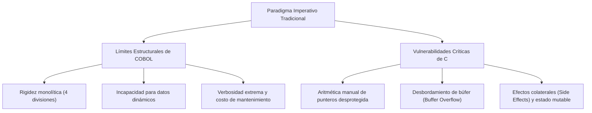
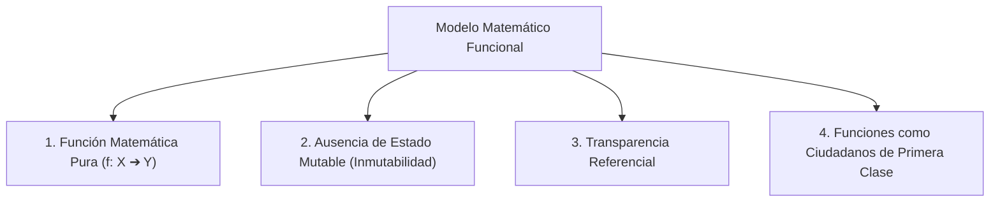
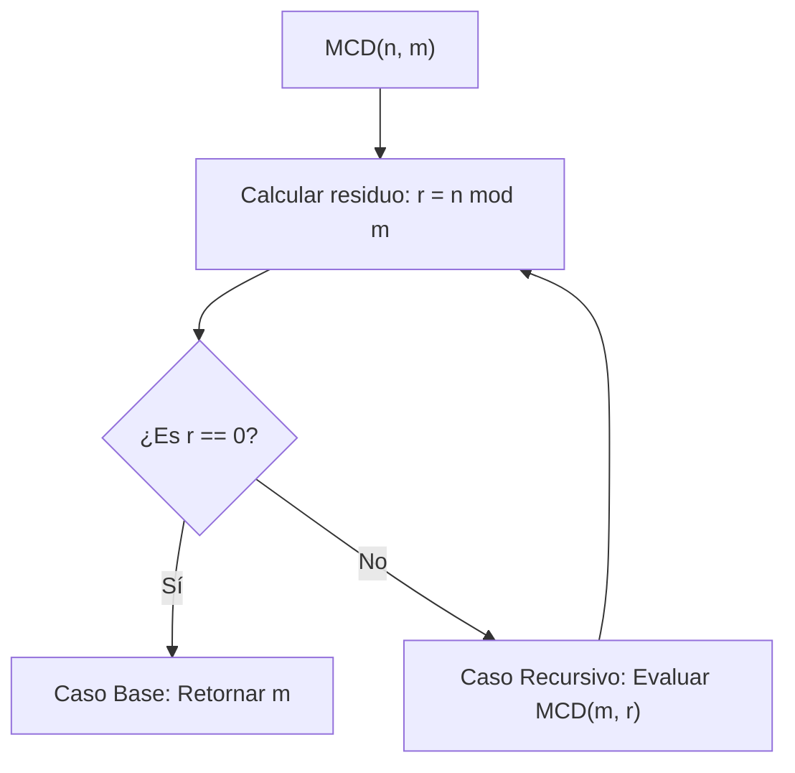

# Guía de Estudio Detallada: Semana 6 - Clase 1
**Curso:** Lenguajes de Programación  
**Profesor:** Jorge Arturo Vargas Calvo  
**Tema:** Crítica a los Límites del Paradigma Imperativo y Fundamentos Matemáticos del Paradigma Funcional  
**Material de Base:** Grabación `Lenguajes semana 6 clase 1.mp4` (Duración: 01:46:55)

---

## 1. Crítica Rigurosa a los Límites del Paradigma Imperativo

La clase inicia con un análisis crítico y fundamentado de por qué el modelo imperativo tradicional (basado en la arquitectura Von Neumann y la modificación secuencial de estados de memoria) presenta fallas estructurales intrínsecas para el software a gran escala.



### 1.1 El Caso de COBOL: Rigidez Estructural y Deuda Técnica
1. **Monolitismo y Falta de Abstracción Dinámica:**
   - La arquitectura obligatoria en cuatro divisiones (`IDENTIFICATION`, `ENVIRONMENT`, `DATA`, `PROCEDURE`) genera un acoplamiento artificial.
   - Todo dato debe reservarse estáticamente en la `DATA DIVISION`. COBOL clásico carece de soporte nativo para estructuras de memoria dinámica de tamaño variable (árboles binarios dinámicos, listas enlazadas en heap, grafos).
2. **Verbosidad Extrema:**
   - La filosofía de parecer "inglés ordinario" multiplica por factores de $5\times$ a $10\times$ el volumen de líneas de código respecto a un lenguaje moderno para una misma lógica.
3. **El Problema del Software Heredado (*Legacy Code*):**
   - Aunque la computación moderna avanzó, la banca mundial procesa billones de dólares diarios sobre sistemas COBOL escritos en los años 70 y 80. La jubilación masiva de los programadores originales ha encarecido exponencialmente su mantenimiento, convirtiéndolo en un riesgo sistémico.

---

### 1.2 El Caso del Lenguaje C: Vulnerabilidades de Memoria y Efectos Colaterales
El profesor expone cómo la proximidad de C con el hardware genera riesgos inherentes a su modelo de ejecución:

#### 1. Aritmética de Punteros y Desbordamiento de Búfer (*Buffer Overflow*):
C no realiza verificación de límites (*bounds checking*) en arreglos ni operaciones con punteros por razones de rendimiento bruto:
```c
void funcion_insegura(char *entrada) {
    char buffer[16];
    // Si 'entrada' mide más de 16 bytes, se sobrescribe la pila (call stack)
    strcpy(buffer, entrada); 
}
```
* **Consecuencia:** La escritura más allá del límite del arreglo sobrescribe el registro del puntero de instrucción base ($EBP/RBP$) y la **dirección de retorno ($RIP$)**, permitiendo a atacantes redirigir el flujo de control hacia código malicioso (inyección de *shellcode*).

#### 2. Corrupción del Montículo (*Heap Corruption*):
- **Punteros Colgantes (*Dangling Pointers*):** Un puntero que sigue referenciando una dirección de memoria tras ser liberada con `free()`.
- **Fugas de Memoria (*Memory Leaks*):** Memoria reservada con `malloc()` que pierde su referencia sin liberarse, saturando progresivamente la RAM.
- **Doble Liberación (*Double Free*):** Liberar dos veces el mismo bloque de memoria, corrompiendo la tabla interna del asignador del sistema operativo.

#### 3. Efectos Colaterales (*Side Effects*) y Pérdida de Determinismo:
En el paradigma imperativo, las funciones pueden modificar variables globales o punteros compartidos de forma invisible:
```c
int estado_global = 10;

int f(int x) {
    estado_global += x;  // Efecto colateral: muta un estado externo
    return estado_global * 2;
}

// En una expresión como:
int resultado = f(5) + f(5);
```
* Dependiendo de si el compilador evalúa el operando izquierdo o el derecho primero, el comportamiento puede generar resultados inconsistentes. La noción matemática de que $a + a = 2a$ deja de cumplirse si la evaluación altera el estado.

---

## 2. Fundamentos Matemáticos del Paradigma Funcional

Para superar las deficiencias del modelo Von Neumann, el paradigma funcional se edifica sobre la solidez de las matemáticas formales y el **Cálculo Lambda ($\lambda$-calculus)** desarrollado por Alonzo Church en 1936.



### 2.1 Definición Conjuntista Formal de Función
> **Definición:** Dados dos conjuntos $X$ (dominio) e $Y$ (codominio), una **función** $f$ es una relación binaria $f \subseteq X \times Y$ que cumple la propiedad de **unívoca correspondencia**:
> $$\forall x \in X, \quad \exists! y \in Y \quad \text{tal que} \quad (x, y) \in f$$
> Denotado equivalentemente como $f(x) = y$.

A diferencia de un procedimiento imperativo (que es un conjunto de instrucciones que ejecutan efectos temporales sobre la máquina), una función matemática pura es simplemente un **mapeo estático entre dominios**.

### 2.2 Las Tres Propiedades Esenciales de la Función Pura

#### 1. Determinismo Matemático (Pureza):
Una función pura siempre produce exactamente la misma salida cuando se le suministran los mismos argumentos de entrada:
$$\forall x_1, x_2 \in X : x_1 = x_2 \implies f(x_1) = f(x_2)$$
No depende del tiempo de reloj, de la memoria física, ni de ninguna entrada del usuario durante su ejecución.

#### 2. Ausencia Total de Efectos Secundarios (*No Side Effects*):
La evaluación de una función pura tiene como único impacto visible la producción de su valor de retorno. No modifica el entorno exterior, no muta variables compartidas, ni altera estados de archivos o pantallas.

#### 3. Transparencia Referencial:
> **Principio de Transparencia Referencial:** Una expresión $E$ es referencialmente transparente si puede ser reemplazada directamente por su valor resultante $v$ en cualquier lugar del programa sin alterar en lo absoluto el significado ni el resultado final de la computación:
> $$P[E] \equiv P[v], \quad \text{donde } v = \text{eval}(E)$$

*Ejemplo:* Si en matemáticas sabemos que $f(2) = 4$, la ecuación $y = f(2) + f(2)$ es rigurosamente equivalente a $y = 4 + 4 = 8$. En programación funcional pura esta garantía se mantiene siempre, posibilitando optimizaciones agresivas del compilador como la **memoización**, la **vectorización** y la **ejecución paralela masiva libre de bloqueos (*locks*)**.

---

## 3. Modelado Matemático de Algoritmos: MCD y mcm

El profesor formaliza cómo un algoritmo clásico debe formularse en el paradigma funcional como una función matemática pura recursiva por casos, utilizando como estudio el Algoritmo de Euclides.



### 3.1 Teorema de la División Entera de Euclides
> Dados dos números enteros $n, m \in \mathbb{Z}^+$ con $m > 0$, existen únicos enteros $q$ (cociente) y $r$ (residuo) tales que:
> $$n = q \cdot m + r, \quad \text{con } 0 \le r < m$$

### 3.2 Lema Fundamental del Algoritmo de Euclides
> Si $n = q \cdot m + r$, entonces el conjunto de divisores comunes de $n$ y $m$ es exactamente idéntico al conjunto de divisores comunes de $m$ y $r$. En consecuencia:
> $$\gcd(n, m) = \gcd(m, r)$$

### 3.3 Definición Matemática Funcional Recursiva
El profesor establece la función formal por partes:

$$MCD(n, m) = \begin{cases} 
m & \text{si } (n = q \cdot m + r) \land (r = 0) \\ 
MCD(m, r) & \text{en caso contrario (donde } r = n \pmod m \text{)}
\end{cases}$$

#### Demostración Formal de Terminación:
Para garantizar que la función es computable y no genera un bucle infinito, se define una función de orden bien fundado sobre los argumentos:
1. En cada llamada recursiva $MCD(m, r)$, el nuevo segundo argumento $r$ satisface:
   $$0 \le r < m$$
2. Dado que los residuos forman una sucesión estrictamente decreciente de números naturales:
   $$m > r_1 > r_2 > \dots \ge 0$$
3. Por el principio del buen orden de $\mathbb{N}$, no existe una sucesión infinita estrictamente decreciente de enteros no negativos. Por lo tanto, forzosamente en un número finito de pasos se alcanza $r_k = 0$, disparando el caso base y terminando la ejecución.

---

### 3.4 Derivación del Mínimo Común Múltiplo ($mcm$)
A partir del Teorema Fundamental de la Aritmética, para cualquier par de enteros positivos $a$ y $b$:
$$a \cdot b = \gcd(a, b) \cdot \text{lcm}(a, b)$$

Despejando algebraicamente el Mínimo Común Múltiplo:
$$mcm(a, b) = \frac{|a \cdot b|}{MCD(a, b)}$$

*Esta formulación reduce el cálculo del $mcm$ a una composición pura de multiplicación, división entera y la llamada a la función pura $MCD$.*

---

## 4. Material Extra de Refuerzo para el Examen

### 4.1 Traza Matemática Paso a Paso del Algoritmo de Euclides
Supongamos que el examen solicita calcular $MCD(252, 105)$:

1. **Paso 1:** $n = 252$, $m = 105$.
   - División: $252 = 2 \cdot 105 + 42 \implies r = 42 \neq 0$.
   - Como $r \neq 0 \implies MCD(252, 105) = MCD(105, 42)$.
2. **Paso 2:** $n = 105$, $m = 42$.
   - División: $105 = 2 \cdot 42 + 21 \implies r = 21 \neq 0$.
   - Como $r \neq 0 \implies MCD(105, 42) = MCD(42, 21)$.
3. **Paso 3:** $n = 42$, $m = 21$.
   - División: $42 = 2 \cdot 21 + 0 \implies r = 0$.
   - Caso base alcanzado ($r = 0$) $\implies$ Retorna $m = 21$.

**Resultado:**
$$MCD(252, 105) = 21$$
$$mcm(252, 105) = \frac{252 \cdot 105}{21} = 252 \cdot 5 = 1260$$

---

### 4.2 Complejidad Algorítmica y Teorema de Lamé (1844)
- **Pregunta teórica frecuente:** ¿Cuál es la cota superior del número de pasos requeridos por el Algoritmo de Euclides?
- **Teorema de Gabriel Lamé:** El número de divisiones sucesivas requeridas por el algoritmo de Euclides para dos enteros $n \ge m > 0$ **nunca supera 5 veces el número de dígitos decimales de $m$**.
- En términos asintóticos de complejidad computacional:
  $$\mathcal{O}(\log(\min(n, m)))$$
- El peor caso ocurre cuando $n$ y $m$ son **dos números consecutivos de la sucesión de Fibonacci** ($F_{k+1}$ y $F_k$), pues en cada división el cociente es siempre $q = 1$ y el residuo es el término anterior de Fibonacci:
  $$F_{k+1} = 1 \cdot F_k + F_{k-1}$$

---

### 4.3 Banco de Preguntas de Autoevaluación

1. **¿Por qué la ausencia de efectos secundarios (*side effects*) simplifica radicalmente la concurrencia y el paralelismo?**
   * *Respuesta:* Porque las condiciones de carrera (*race conditions*) y los interbloqueos (*deadlocks*) ocurren exclusivamente cuando múltiples hilos intentan leer y mutar simultáneamente la misma región de memoria compartida. Al no existir estados mutables en el paradigma funcional puro, cualquier cantidad de hilos puede evaluar expresiones en paralelo sin necesidad de primitivas de sincronización costosas como *mutexes* o semáforos.

2. **¿Qué relación existe entre la transparencia referencial y la técnica de optimización denominada *Memoización*?**
   * *Respuesta:* La memoización consiste en almacenar en una tabla de consulta los resultados previamente calculados de una función para no recomputarlos en llamadas futuras. Esto es estrictamente válido y seguro únicamente si la función goza de transparencia referencial; de lo contrario, una llamada futura podría requerir un valor distinto debido a cambios en el estado global.

3. **¿Cuál es la causa técnica de que un *Buffer Overflow* permita la ejecución arbitraria de código en C?**
   * *Respuesta:* En la arquitectura x86/ARM estándar, las variables locales y la dirección de retorno de la función residen en el mismo bloque contiguo de la pila (*stack frame*). Al escribir datos que sobrepasen el tamaño del arreglo local sin control de límites, los bytes excedentes sobreescriben la dirección de retorno, permitiendo que al retornar la función (`RET`), el procesador salte a la dirección inyectada por el atacante.
