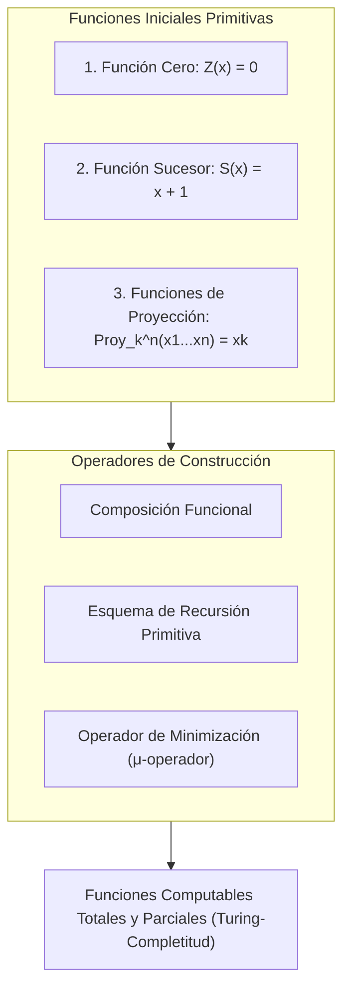
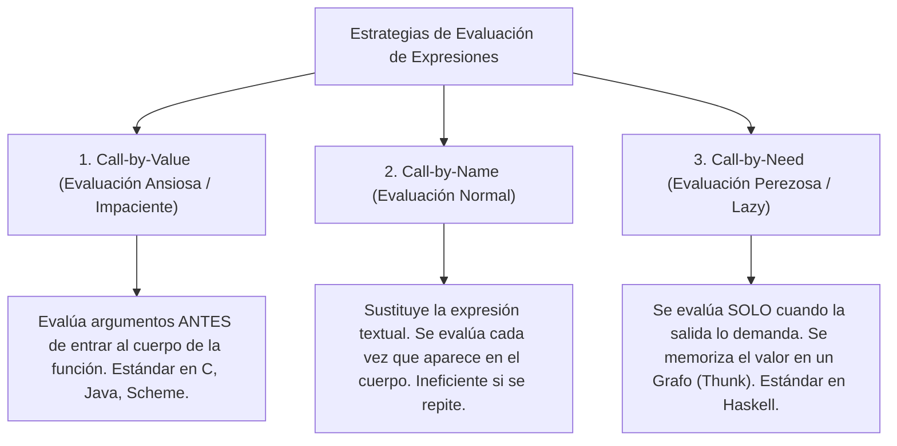

# Guía de Estudio Detallada: Semana 6 - Clase 2
**Curso:** Lenguajes de Programación  
**Profesor:** Jorge Arturo Vargas Calvo  
**Tema:** Teoría de Computabilidad Funcional, Funciones Primitivas Recursivas, Evaluación Perezosa y Arquitectura Funcional  
**Material de Base:** Grabación `Lenguajes semana 6 clase 2.mp4` (Duración: 01:45:28)

---

## 1. Teoría de la Computabilidad y Funciones Primitivas Recursivas

El profesor conecta las bases del paradigma funcional con los fundamentos matemáticos de la computabilidad desarrollados por Kurt Gödel y Stephen Kleene en la década de 1930.



### 1.1 Las Tres Funciones Iniciales Primitivas
En la teoría formal de funciones recursivas, toda computación computable sobre los números naturales $\mathbb{N}$ parte exclusivamente de tres funciones elementales:

1. **Función Cero ($Z$):**
   $$Z(x) = 0, \quad \forall x \in \mathbb{N}$$
   Mapea cualquier argumento al elemento neutro aditivo.

2. **Función Sucesor ($S$):**
   $$S(x) = x + 1, \quad \forall x \in \mathbb{N}$$
   Genera el siguiente número natural en la secuencia de Peano.

3. **Funciones de Proyección ($\text{Proy}_k^n$ / $\pi_k^n$):**
   $$\text{Proy}_k^n(x_1, x_2, \dots, x_n) = x_k, \quad \text{donde } 1 \le k \le n$$
   Permite seleccionar una variable específica de una tupla de $n$ componentes descartando las demás (la base matemática del paso de parámetros posicionales).

### 1.2 Operadores de Construcción
A partir de las funciones iniciales, se construyen funciones de mayor complejidad mediante:
- **Composición:** $h(x) = f(g_1(x), g_2(x), \dots, g_m(x))$
- **Esquema de Recursión Primitiva:**
  $$\begin{aligned}
  f(0, \vec{y}) &= g(\vec{y}) \\
  f(S(x), \vec{y}) &= h(x, f(x, \vec{y}), \vec{y})
  \end{aligned}$$
- **La Función Condicional Pura:**
  $$\text{Cond}(b, t, e) = \begin{cases} t & \text{si } b = 1 \text{ (verdadero)} \\ e & \text{si } b = 0 \text{ (falso)} \end{cases}$$
  En lugar de una bifurcación de flujo en la CPU, la condición se modela como una función matemática pura que mapea un valor booleano a una de dos expresiones.

---

## 2. Arquitectura de un Programa Funcional vs. Imperativo

El diseño de sistemas en ambos paradigmas responde a filosofías diametralmente opuestas:

```mermaid
flowchart TD
    subgraph Modelo_Imperativo ["Arquitectura Imperativa (Von Neumann)"]
        I1["Estado Inicial: Memoria M0"] --> I2["Instrucción 1 (Asignación)"]
        I2 --> I3["Estado Mutado: M1"]
        I3 --> I4["Instrucción 2 (Bucle / Mutación)"]
        I4 --> I5["Estado Final: M_n (Efecto Colateral)"]
    end

    subgraph Modelo_Funcional ["Arquitectura Funcional Pura (Cálculo Lambda)"]
        F1["Dato de Entrada x"] --> F2["Función Pura f(x)"]
        F2 --> F3["Valor Intermedio Inmutable y"]
        F3 --> F4["Función Pura g(y)"]
        F4 --> F5["Valor de Salida z = g(f(x))"]
    end
```



| Dimensión Arquitectural | Paradigma Imperativo | Paradigma Funcional |
| :--- | :--- | :--- |
| **Componente Rector** | Procedimiento principal `main()` que orquesta mutaciones. | Expresión raíz de nivel superior (*top-level expression*). |
| **Estructuración Interna** | Rutinas con variables globales, locales y pasos por referencia. | Colección modular de definiciones de funciones puras independientes. |
| **Flujo de Ejecución** | Orden temporal estricto instrucción por instrucción. | Reducción de expresiones mediante composición y sustitución matemática. |
| **Estado de Datos** | Celdas de memoria mutables sobrescritas destructivamente. | Inmutabilidad estricta: los datos nunca se modifican, se transforman. |

---

## 3. Sintaxis y Notación Comparativa: Scheme vs. Haskell

La clase analiza cómo se implementa la abstracción funcional en dos de los lenguajes más representativos de la historia informática:

### 3.1 Scheme: Minimalismo y Expresiones S (Notación Prefija)
- Heredero directo de LISP y el cálculo lambda.
- Toda operación y llamada a función se escribe en notación prefija entre paréntesis balanceados:
  $$(operador \quad arg_1 \quad arg_2 \dots arg_n)$$
- No existe distinción sintáctica entre operadores aritméticos y funciones definidas por el usuario (`+`, `*`, `mcd` tienen la misma posición sintáctica):
  ```scheme
  ; Definición formal de función con parámetros
  (define (sumaprod a b c)
    (+ (* a b) c))
  ```

### 3.2 Haskell: Notación Hindley-Milner y Currificación (*Currying*)
- Lenguaje funcional puro con tipado estático avanzado.
- **Firmas de Tipos Explícitas:** Se especifican con `::` y flechas `->`:
  ```haskell
  sumaprod :: Int -> Int -> Int -> Int
  sumaprod a b c = (a * b) + c
  ```
- **Concepto Teórico de Currificación (*Currying*):**
  Nombrado en honor al lógico Haskell Curry. En Haskell, **ninguna función toma más de un argumento**. Una función aparentemente de $n$ parámetros es en realidad una cadena de funciones de **un solo argumento** que retorna otra función:
  $$f :: A \to B \to C \quad \Longleftrightarrow \quad f :: A \to (B \to C)$$
  Esto permite la **aplicación parcial** sin sintaxis especial:
  ```haskell
  duplicar :: Int -> Int
  duplicar = (*) 2    -- Aplicación parcial de la función multiplicación
  ```

---

## 4. Mecanismos y Estrategias de Evaluación

Uno de los temas más profundos abordados en la sesión es cómo y cuándo un lenguaje de programación evalúa los argumentos de una función.



### 4.1 Evaluación Ansiosa / Impaciente (*Call-by-Value*)
- Los argumentos de la función se evalúan **antes** de que el control entre al cuerpo de la función.
- *Ventaja:* Modelo mental predecible y directo para arquitecturas Von Neumann.
- *Desventaja:* Si un argumento requiere un cómputo astronómico pero dentro de la función nunca se utiliza (o se descarta condicionalmente), el tiempo de cómputo se desperdicia por completo.

### 4.2 Evaluación Normal (*Call-by-Name*)
- Los argumentos se sustituyen textualmente sin evaluar dentro del cuerpo de la función.
- *Desventaja:* Si el argumento aparece $k$ veces dentro del cuerpo, la expresión se evaluará y calculará $k$ veces distintas de forma redundante.

### 4.3 Evaluación Perezosa (*Lazy Evaluation* / *Call-by-Need*)
Adoptada por diseño en **Haskell**:
- Una expresión no se evalúa hasta que su valor sea estrictamente necesario para producir un resultado observable (ej. imprimir en pantalla o decidir una guarda condicional).
- **El Mecanismo de los *Thunks* (Suspensiones):**
  Cuando se pasa una expresión como argumento en Haskell, el compilador crea en memoria un objeto llamado **Thunk** (un puntero al código de la expresión y su entorno de variables).
  - Al demandarse su valor por primera vez, el *thunk* se evalúa (reducción de grafo).
  - El resultado computado se **sobrescribe en el mismo nodo de memoria** (*memoización implícita*).
  - Si el código vuelve a solicitar el valor, se lee el resultado instantáneamente sin recomputar.

```
       ANTES DE EVALUAR:                      DESPUÉS DE EVALUAR:
    Nodo Argumento ───> [ THUNK: (2^1000) ]     Nodo Argumento ───> [ VALOR: 1071508607... ]
```

#### Implicaciones Revolucionarias de la Evaluación Perezosa:
1. **Estructuras de Datos Infinitas:**  
   Es posible definir listas infinitas de forma matemáticamente consistente:
   ```haskell
   enteros = [1..]          -- Lista infinita de los números naturales: 1, 2, 3, ...
   pares   = [2, 4..]       -- Lista infinita de números pares

   primerosDiez = take 10 enteros  -- Produce [1,2,3,4,5,6,7,8,9,10] y SE DETIENE
   ```
   El programa jamás se congela ni agota la RAM porque solo se calculan los elementos que `take` demanda activamente.
2. **Desacoplamiento Generador-Consumidor:**  
   Un módulo puede enfocarse en generar el espacio total de posibles soluciones (incluso infinito), mientras que otro módulo filtra y decide cuándo detenerse, sin interacción acoplada.

---

## 5. Transformación de Constructos Imperativos a Funcionales

Para programar en el paradigma funcional, se deben desterrar los patrones mentales de la programación imperativa:

### 5.1 Eliminación de Bucles Iterativos $\to$ Recursión de Cola (*Tail Recursion*)
En programación imperativa los bucles dependen de contadores mutables (`i = i + 1`). En programación funcional pura se utiliza **recursión con acumulador**.

#### Bucle Imperativo Clásico (Factorial en C):
```c
int factorial(int n) {
    int acc = 1;
    for (int i = 1; i <= n; i++) {
        acc = acc * i;
    }
    return acc;
}
```

#### Transformación a Recursión de Cola en Haskell:
```haskell
factorial :: Integer -> Integer
factorial n = factAux n 1
  where
    factAux 0 acc = acc
    factAux k acc = factAux (k - 1) (k * acc)  -- Llamada recursiva en posición de cola pura
```

#### Optimización de Llamada de Cola (TCO - *Tail-Call Optimization*):
- En una función recursiva ordinaria (como `fact n = n * fact (n - 1)`), la multiplicación queda pendiente, obligando a apilar un nuevo marco en el *call stack* por cada llamada ($\mathcal{O}(n)$ en memoria).
- En la **recursión de cola**, la llamada a la función es la **última operación absoluta** del bloque. El compilador detecta esto y no apila un nuevo marco; en su lugar, simplemente sobrescribe los parámetros y ejecuta un salto incondicional de bajo nivel (`JMP`), logrando consumo de memoria espacial **$\mathcal{O}(1)$ (constante)**, idéntico a un bucle `while` en ensamblador.

---

### 5.2 Eliminación de Condicionales Imperativos $\to$ Guardas y Pattern Matching
En lugar de sentencias imperativas `if-else` o `switch-case`, los lenguajes funcionales emplean **coincidencia de patrones (*Pattern Matching*)** y **guardas lógicas**:

```haskell
-- Implementación funcional mediante Guardas (|)
signo :: (Num a, Ord a) => a -> String
signo x
  | x > 0     = "Positivo"
  | x < 0     = "Negativo"
  | otherwise = "Cero"

-- Implementación funcional mediante Pattern Matching directo
describirLista :: [a] -> String
describirLista []      = "Lista completamente vacía"
describirLista [x]     = "Lista de un único elemento"
describirLista (x:xs)  = "Lista con cabeza y resto"
```

---

## 6. Material Extra de Refuerzo para el Examen

### 6.1 Traza de Evaluación Perezosa con Expresiones Condicionales
Considere la siguiente función en Haskell:
```haskell
constante :: Int -> Int -> Int
constante a b = a + 10
```
Suponga la llamada:
```haskell
constante 5 (loopInfinito 1)  -- donde loopInfinito x = loopInfinito (x + 1)
```

- **Bajo evaluación ansiosa (Call-by-value / C / Scheme):**
  El programa evalúa primero `loopInfinito 1`. Como entra en un ciclo infinito, el programa se cuelga y jamás ejecuta la función `constante`.
- **Bajo evaluación perezosa (Call-by-need / Haskell):**
  Haskell inspecciona el cuerpo de `constante a b = a + 10`. Identifica que el parámetro `b` **no interviene** en el cálculo del resultado final. En consecuencia, el *thunk* asociado a `(loopInfinito 1)` es ignorado por completo, evaluando únicamente `5 + 10 = 15`. La computación termina exitosamente.

---

### 6.2 Banco de Preguntas de Autoevaluación

1. **¿Qué son las funciones de proyección ($\text{Proy}_k^n$) en la teoría de funciones primitivas recursivas y cuál es su utilidad práctica en lenguajes de programación?**
   * *Respuesta:* Son funciones base de la teoría de Kleene que toman una $n$-tupla de argumentos y retornan exclusivamente el $k$-ésimo componente ($\text{Proy}_k^n(x_1, \dots, x_n) = x_k$). En la teoría de lenguajes de programación, modelan la capacidad de una función o procedimiento para seleccionar y acceder a parámetros formales específicos descartando los restantes.

2. **¿Por qué la Currificación (*Currying*) hace que todas las funciones en Haskell sean tratadas formalmente como funciones de un solo parámetro?**
   * *Respuesta:* Porque la sintaxis de tipos $A \to B \to C$ se asocia formalmente como $A \to (B \to C)$. Al recibir el primer argumento de tipo $A$, la función no retorna el resultado final, sino que retorna una **nueva función intermedia** que espera un argumento de tipo $B$ para producir el resultado de tipo $C$.

3. **¿Cuál es la diferencia fundamental entre la evaluación por nombre (*Call-by-Name*) y la evaluación perezosa (*Call-by-Need*)?**
   * *Respuesta:* Ambas postergan la evaluación de los argumentos hasta que su valor sea demandado. Sin embargo, *Call-by-Name* re-evalúa la expresión cada vez que su identificador se utiliza dentro del cuerpo, mientras que *Call-by-Need* memoriza el resultado calculado en un grafo compartido (*thunk*), garantizando que la expresión se evalúe como máximo una sola vez.

4. **¿Qué condición estricta debe cumplir una función recursiva para que el compilador pueda aplicar la Optimización de Llamada de Cola (TCO)?**
   * *Respuesta:* La llamada recursiva debe ser la última operación evaluada en la rama de ejecución. No puede haber ninguna operación matemática, lógica o compositiva pendiente después del retorno de dicha llamada (por ejemplo, en `n * fact(n-1)`, la multiplicación impide la TCO porque se ejecuta después de la llamada recursiva).
