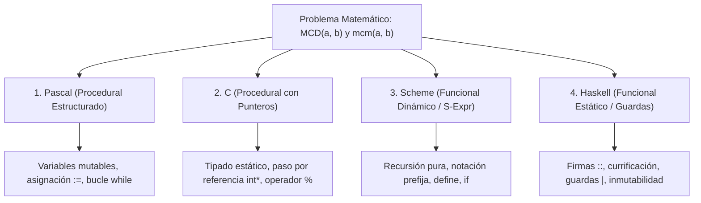
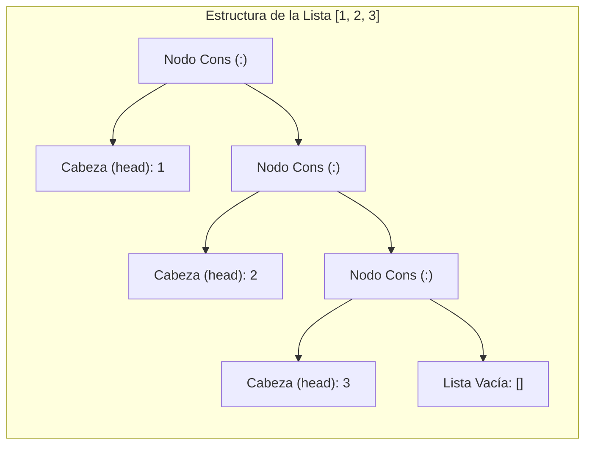
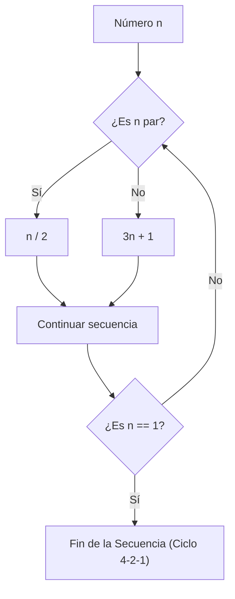

# Guía de Estudio Detallada: Semana 7 - Clase 2
**Curso:** Lenguajes de Programación  
**Profesor:** Jorge Arturo Vargas Calvo  
**Tema:** Estudio Comparativo Multiparadigma Práctico (Pascal, C, Scheme, Haskell), Listas y Cadenas en Haskell, y Conjetura de Collatz (Hailstone)  
**Material de Base:** Grabación `Lenguajes semana 7 clase 2.mp4` (Duración: 01:34:44)

---

## 1. Estudio Práctico Comparativo: Implementación de MCD y mcm en 4 Lenguajes

En esta sesión magistral, el profesor realiza una comparativa exhaustiva del **Algoritmo de Euclides para el Máximo Común Divisor ($MCD$)** y el cálculo del **Mínimo Común Múltiplo ($mcm$)** a través de cuatro lenguajes representativos de distintos paradigmas de programación:



---

### 1.1 Implementación en Pascal (Procedural Estructurado Clásico)
Pascal destaca por su tipado rígido, bloques delimitados por `begin ... end`, y la separación estricta entre la declaración de variables (`var`) y las instrucciones ejecutables:

```pascal
program ComparativaEuclidesPascal;

var
    numeroA, numeroB: integer;
    resultadoMCD, resultadoMCM: integer;

{ Función que implementa el algoritmo de Euclides de forma iterativa }
function CalcularMCD(a, b: integer): integer;
var
    temp: integer;
begin
    while b <> 0 do
    begin
        temp := b;
        b := a mod b;   { Asignación destructiva del residuo }
        a := temp;      { a toma el divisor anterior }
    end;
    CalcularMCD := a;   { En Pascal el retorno se asigna al nombre de la función }
end;

{ Función para calcular el Mínimo Común Múltiplo }
function CalcularMCM(a, b: integer): integer;
begin
    CalcularMCM := (a * b) div CalcularMCD(a, b);
end;

begin
    numeroA := 48;
    numeroB := 18;
    
    resultadoMCD := CalcularMCD(numeroA, numeroB);
    resultadoMCM := CalcularMCM(numeroA, numeroB);
    
    writeln('MCD de ', numeroA, ' y ', numeroB, ' es: ', resultadoMCD);
    writeln('mcm de ', numeroA, ' y ', numeroB, ' es: ', resultadoMCM);
end.
```

#### Análisis Técnico (Pascal):
- **Manejo del Estado:** Completamente **mutable**. Las variables `a`, `b` y `temp` son sobrescritas en cada iteración del bucle `while`.
- **Estructura del Programa:** Requiere declarar el encabezado `program`, declarar los identificadores en la sección `var`, y delimitar bloques ejecutables con `begin` y `end`.

---

### 1.2 Implementación en C (Procedural de Sistemas con Funciones)
En C se observa la sintaxis de llaves `{ ... }`, el operador módulo `%` y la manipulación de funciones con retorno explícito `return`:

```c
#include <stdio.h>

/* Función que calcula el MCD de forma iterativa utilizando el algoritmo de Euclides */
int mcd(int a, int b) {
    while (b != 0) {
        int temp = b;
        b = a % b;
        a = temp;
    }
    return a;
}

/* Función para calcular el mcm apoyada en el mcd */
int mcm(int a, int b) {
    return (a * b) / mcd(a, b);
}

/* Variante que ilustra el paso por referencia mediante punteros */
void mcd_por_referencia(int a, int b, int *resultado) {
    while (b != 0) {
        int temp = b;
        b = a % b;
        a = temp;
    }
    *resultado = a; /* Asignación a la dirección de memoria apuntada */
}

int main(void) {
    int a = 48, b = 18;
    int res_mcd = mcd(a, b);
    int res_mcm = mcm(a, b);
    
    printf("--- Paradigma Procedural en C ---\n");
    printf("MCD(%d, %d) = %d\n", a, b, res_mcd);
    printf("mcm(%d, %d) = %d\n", a, b, res_mcm);
    
    return 0;
}
```

#### Análisis Técnico (C):
- **Modelo de Memoria:** Variables asignadas en la pila de llamadas (*stack frame*).
- Posibilidad de causar efectos colaterales si se utilizan punteros sin protección de constancia (`const`).

---

### 1.3 Implementación en Scheme (Funcional Dinámico con Expresiones S)
El profesor realiza la demostración en vivo sobre el intérprete interactivo web `chrispyles.io/scheme-interpreter`. Scheme prescinde de bucles imperativos, resolviendo el problema mediante **recursión pura**:

```scheme
; ==========================================================
; Implementación Funcional Pura en Scheme (Dialecto de LISP)
; ==========================================================

; Definición de la función pura MCD usando el algoritmo de Euclides
(define (mcd a b)
  (if (= (remainder a b) 0)
      b
      (mcd b (remainder a b))))

; Definición de la función mcm utilizando composición funcional pura
(define (mcm a b)
  (/ (* a b) (mcd a b)))

; --- Pruebas Interactivas en el REPL ---
; (mcd 48 18)
; => Devuelve 6
; (mcm 48 18)
; => Devuelve 144
```

#### Traza Recursiva Paso a Paso en Scheme para `(mcd 48 18)`:
1. `(mcd 48 18)`:
   - Se evalúa `(remainder 48 18)`. Dado que $48 = 2 \cdot 18 + 12$, el residuo es `12`.
   - Se evalúa la condición `(= 12 0)` $\to$ `#f` (falso).
   - Se evalúa la rama alternativa: `(mcd 18 12)`.
2. `(mcd 18 12)`:
   - Se evalúa `(remainder 18 12)`. Como $18 = 1 \cdot 12 + 6$, el residuo es `6`.
   - Condición `(= 6 0)` $\to$ `#f`.
   - Se evalúa la rama alternativa: `(mcd 12 6)`.
3. `(mcd 12 6)`:
   - Se evalúa `(remainder 12 6)`. Como $12 = 2 \cdot 6 + 0$, el residuo es `0`.
   - Condición `(= 0 0)` $\to$ `#t` (verdadero).
   - Se dispara el caso base: retorna el valor de `b`, que es **`6`**.

*Nótese que la llamada recursiva `(mcd b (remainder a b))` está en posición de cola (*tail position*), permitiendo que el intérprete de Scheme aplique TCO y ejecute en memoria espacial $\mathcal{O}(1)$.*

---

### 1.4 Implementación en Haskell (Funcional Puro Estático con Guardas)
En Haskell, el algoritmo se expresa con máxima elegancia matemática mediante **firmas de tipos**, **guardas lógicas** y el operador de módulo en notación infija:

```haskell
-- ==========================================================
-- Implementación Funcional Pura en Haskell
-- ==========================================================

-- Firma de tipos: Función pura que toma dos Int y produce un Int
mcd :: Int -> Int -> Int
mcd a b
  | a `mod` b == 0 = b
  | otherwise      = mcd b (a `mod` b)

-- Función pura para el Mínimo Común Múltiplo
mcm :: Int -> Int -> Int
mcm a b = (a * b) `div` (mcd a b)
```

#### Traza de Reducción Funcional en Haskell para `mcd 48 18`:
$$\begin{aligned}
\text{mcd } 48 \ 18 &\implies 48 \text{ \texttt{`mod`} } 18 = 12 \neq 0 \implies \text{otherwise} \implies \text{mcd } 18 \ (48 \text{ \texttt{`mod`} } 18) \\
                    &\implies \text{mcd } 18 \ 12 \\
                    &\implies 18 \text{ \texttt{`mod`} } 12 = 6 \neq 0 \implies \text{otherwise} \implies \text{mcd } 12 \ (18 \text{ \texttt{`mod`} } 12) \\
                    &\implies \text{mcd } 12 \ 6 \\
                    &\implies 12 \text{ \texttt{`mod`} } 6 = 0 \implies \text{Guarda Cumplida!} \implies 6
\end{aligned}$$

---

### 1.5 Matriz Comparativa Técnica entre los 4 Lenguajes

| Criterio | Pascal | C | Scheme | Haskell |
| :--- | :--- | :--- | :--- | :--- |
| **Paradigma Primario** | Imperativo / Procedural | Imperativo / Procedural | Funcional (Dialecto LISP) | Funcional Puro |
| **Sistema de Tipos** | Estático, fuerte | Estático, débil (conversiones implícitas) | Dinámico, fuerte | Estático, fuerte con inferencia (Hindley-Milner) |
| **Gestión de Memoria** | Pila / Manual | Pila / Manual (`malloc`, `free`) | Automática (*Garbage Collector*) | Automática (*Garbage Collector*) |
| **Estrategia de Control** | Bucles imperativos (`while`, `for`) | Bucles imperativos (`while`, `for`) | Recursión pura (con TCO obligatoria) | Recursión pura, guardas y *Pattern Matching* |
| **Evaluación de Argumentos** | Ansiosa (*Call-by-value*) | Ansiosa (*Call-by-value*) | Ansiosa (*Call-by-value*) | **Perezosa (*Call-by-need*)** |
| **Manejo del Estado** | Variables mutables con `:=` | Variables mutables con `=` y punteros `*` | Inmutable por defecto (aunque existe `set!`) | **Estrictamente Inmutable** |

---

## 2. Estructuras de Datos en Haskell: Listas y Cadenas

El profesor dedica una sección fundamental de la clase a detallar el funcionamiento de las **Listas** en Haskell, al ser la estructura de datos primordial del lenguaje.



### 2.1 Definición y Operadores Primitivos
En Haskell, una lista es un tipo de dato algebraico homogéneo (todos sus elementos deben ser del mismo tipo):
- **Constructor Cons (`:`):** Agrega un elemento a la cabeza de una lista en tiempo $\mathcal{O}(1)$:
  ```haskell
  1 : [2, 3, 4]    -- Produce [1, 2, 3, 4]
  1 : 2 : 3 : []   -- Forma canónica equivalente a [1, 2, 3]
  ```
- **Operaciones Básicas:**
  - `head [10, 20, 30]` $\to$ `10` (retorna el primer elemento).
  - `tail [10, 20, 30]` $\to$ `[20, 30]` (retorna la lista restante sin la cabeza).
  - `null []` $\to$ `True` (predicado de verificación de lista vacía).
  - `[1, 2] ++ [3, 4]` $\to$ `[1, 2, 3, 4]` (operador de concatenación $\mathcal{O}(n)$).

### 2.2 Generación por Rangos Aritméticos
Haskell provee azúcar sintáctico de gran potencia para generar secuencias numéricas:
```haskell
rango1 = [1..10]        -- [1, 2, 3, 4, 5, 6, 7, 8, 9, 10]
rangoPares = [2, 4..20] -- Especifica el paso (4-2=2): [2, 4, 6, 8, 10, 12, 14, 16, 18, 20]
rangoDesc = [10, 9..1]  -- Rango descendente: [10, 9, 8, 7, 6, 5, 4, 3, 2, 1]
```

### 2.3 Listas Infinitas y Evaluación Perezosa
Gracias a que Haskell no evalúa expresiones hasta que su valor es demandado por la salida, es completamente seguro declarar listas infinitas:
```haskell
numerosNaturales = [1..]       -- Secuencia infinita: 1, 2, 3, 4, ...
repetirCinco     = repeat 5    -- Secuencia infinita: 5, 5, 5, ...
ciclo            = cycle [1,2] -- Secuencia infinita: 1, 2, 1, 2, ...

-- Consumo acotado con 'take':
ejemplo = take 5 numerosNaturales  -- Evalúa únicamente [1, 2, 3, 4, 5]
```

### 2.4 Cadenas de Caracteres (`String`)
En Haskell, el tipo `String` no es una estructura monolítica ajena, sino un **alias sintáctico (*type synonym*)** para una lista homogénea de caracteres `[Char]`:
```haskell
type String = [Char]
```
*Consecuencia:* Todas las funciones válidas para listas (`head`, `tail`, `take`, `map`, `filter`, `reverse`) funcionan de manera idéntica e inmediata sobre cadenas de texto:
```haskell
reverse "Haskell"     -- Produce "lleksaH"
take 4 "Programacion" -- Produce "Prog"
'A' : "BC"            -- Produce "ABC"
```

---

## 3. Conjetura de Collatz (*Secuencia Hailstone / Granizo*) en Haskell

El profesor analiza, formula e implementa en código uno de los problemas no resueltos más célebres de las matemáticas: la **Conjetura de Collatz** (planteada por Lothar Collatz en 1937), también conocida como la secuencia del granizo (*Hailstone sequence*).



### 3.1 Formulación Matemática
Dado un entero positivo inicial $n \in \mathbb{Z}^+$:
$$f(n) = \begin{cases} 
\frac{n}{2} & \text{si } n \equiv 0 \pmod 2 \quad (\text{es par}) \\ 
3n + 1 & \text{si } n \equiv 1 \pmod 2 \quad (\text{es impar}) 
\end{cases}$$

La conjetura postula que para **cualquier número entero positivo $n$**, la secuencia generada por la aplicación recursiva reiterada de $f(n)$ siempre alcanza eventualmente el valor **`1`**.

### 3.2 Implementación Modular en Haskell
En clase se construye la solución dividiendo el problema en dos funciones puras:

```haskell
-- Función 1: Calcula el siguiente paso individual de la conjetura
hailstone :: Integer -> Integer
hailstone n
  | n `mod` 2 == 0 = n `div` 2
  | otherwise      = 3 * n + 1

-- Función 2: Construye recursivamente la lista completa de la secuencia hasta 1
hailstoneSeq :: Integer -> [Integer]
hailstoneSeq 1 = [1]
hailstoneSeq n = n : hailstoneSeq (hailstone n)
```

### 3.3 Traza Completa de Ejecución para $n = 6$:
Demostración paso a paso de cómo se evalúa `hailstoneSeq 6`:

1. $n = 6$: es par $\to \text{hailstone}(6) = 6 / 2 = 3$.  
   Lista: `6 : hailstoneSeq 3`
2. $n = 3$: es impar $\to \text{hailstone}(3) = 3(3) + 1 = 10$.  
   Lista: `6 : 3 : hailstoneSeq 10`
3. $n = 10$: es par $\to \text{hailstone}(10) = 10 / 2 = 5$.  
   Lista: `6 : 3 : 10 : hailstoneSeq 5`
4. $n = 5$: es impar $\to \text{hailstone}(5) = 3(5) + 1 = 16$.  
   Lista: `6 : 3 : 10 : 5 : hailstoneSeq 16`
5. $n = 16$: es par $\to 16 / 2 = 8$.  
   Lista: `6 : 3 : 10 : 5 : 16 : hailstoneSeq 8`
6. $n = 8$: es par $\to 8 / 2 = 4$.  
   Lista: `6 : 3 : 10 : 5 : 16 : 8 : hailstoneSeq 4`
7. $n = 4$: es par $\to 4 / 2 = 2$.  
   Lista: `6 : 3 : 10 : 5 : 16 : 8 : 4 : hailstoneSeq 2`
8. $n = 2$: es par $\to 2 / 2 = 1$.  
   Lista: `6 : 3 : 10 : 5 : 16 : 8 : 4 : 2 : hailstoneSeq 1`
9. $n = 1$: **Caso Base alcanzado**. Retorna `[1]`.

**Resultado Final:**
```haskell
hailstoneSeq 6 = [6, 3, 10, 5, 16, 8, 4, 2, 1]
```
*(Posee una longitud de 9 elementos y alcanza una altura máxima de 16).*

---

## 4. Simulación Computacional y Ciencias Físicas

Hacia el cierre de la sesión, el profesor vincula la programación multiparadigma con el modelado computacional en ciencias físicas, haciendo referencia a los experimentos de Veritasium sobre la física de colisiones y rebotes:
- **Discretización del Tiempo ($\Delta t$):** En física teórica las leyes se describen mediante ecuaciones diferenciales continuas ($\frac{d^2 x}{dt^2} = \frac{F}{m}$). En computación, el algoritmo debe transformar el continuo en pasos discretos de simulación:
  $$v(t + \Delta t) = v(t) + a(t)\Delta t$$
  $$x(t + \Delta t) = x(t) + v(t)\Delta t$$
- **Conservación de la Energía vs. Disipación:** Al programar simulaciones físicas (como una pelota rebotando con coeficiente de restitución $e < 1$), los errores de redondeo de punto flotante pueden generar energía artificialmente si el integrador numérico no es simpléctico. Esto evidencia la importancia de la precisión matemática en la elección de lenguajes y algoritmos.

---

## 5. Material Extra de Refuerzo para el Examen

### 5.1 Funciones de Orden Superior Clásicas sobre Listas en Haskell

1. **`map`:** Aplica una función a cada elemento de una lista:
   ```haskell
   map (\x -> x * 2) [1, 2, 3]  -- Produce [2, 4, 6]
   ```
2. **`filter`:** Conserva únicamente los elementos que satisfacen un predicado booleano:
   ```haskell
   filter even [1, 2, 3, 4, 5, 6]  -- Produce [2, 4, 6]
   ```
3. **`foldr` y `foldl` (Reducción / Acumulación):**
   ```haskell
   -- Suma de elementos:
   sumatoria xs = foldl (+) 0 xs
   -- Longitud de una secuencia Hailstone:
   longitudHailstone n = length (hailstoneSeq n)
   ```

---

### 5.2 Ejercicio Práctico de Examen: Filtrado y Transformación

**Problema:** Escriba una función pura en Haskell llamada `paresHailstone :: Integer -> [Integer]` que genere la secuencia de Collatz para un número $n$ dado y retorne **únicamente los números pares** de dicha secuencia.

#### Solución:
```haskell
paresHailstone :: Integer -> [Integer]
paresHailstone n = filter even (hailstoneSeq n)

-- Ejemplo de evaluación:
-- paresHailstone 6 
-- => filter even [6, 3, 10, 5, 16, 8, 4, 2, 1]
-- => [6, 10, 16, 8, 4, 2]
```

---

### 5.3 Banco de Preguntas de Autoevaluación

1. **¿Por qué la función `(mcd a b)` en Scheme no desborda la pila de llamadas al procesar números que requieren cientos de divisiones recursivas?**
   * *Respuesta:* Porque la llamada recursiva `(mcd b (remainder a b))` se ubica en la posición de cola (*tail position*). Por especificación del estándar IEEE de Scheme, el intérprete está obligado a aplicar la Optimización de Llamada de Cola (TCO), reutilizando el marco de ejecución actual en lugar de asignar memoria en la pila para cada paso.

2. **¿Qué implicación tiene que en Haskell el tipo `String` sea idéntico a `[Char]`?**
   * *Respuesta:* Que no existe una división semántica entre el procesamiento de texto y el procesamiento de listas generales. Todas las funciones de orden superior (`map`, `filter`, `foldr`), constructores (`:`) y operaciones sobre secuencias son inmediatamente aplicables sobre cadenas sin necesidad de funciones especializadas de strings.

3. **¿Cuál es la función del operador infijo con comillas invertidas (\` \`) en Haskell, por ejemplo al escribir ``a `mod` b``?**
   * *Respuesta:* Convierte una función prefija binaria estándar en un operador infijo, permitiendo colocar el nombre de la función entre sus dos argumentos para aproximar la sintaxis al lenguaje matemático ordinario.
